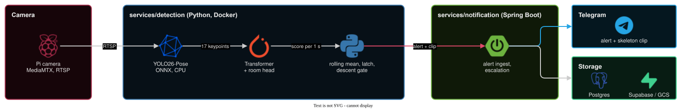
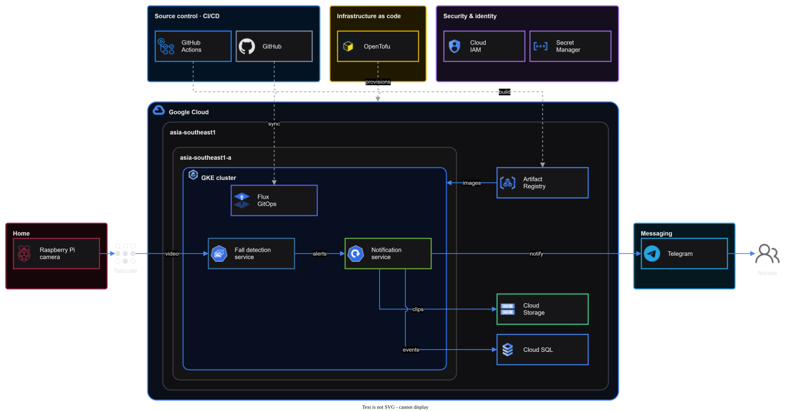
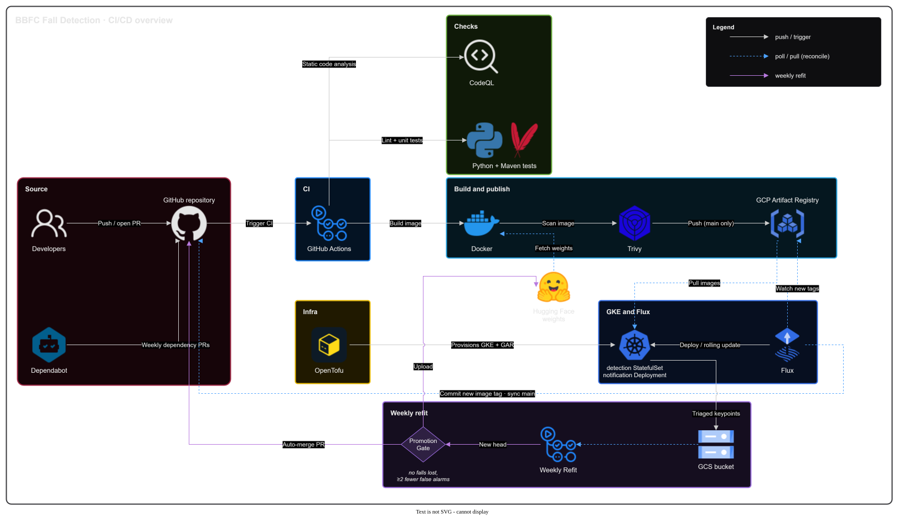

# BBFC Fall Detection System

[](https://github.com/WongYH01/BBFC-FallDetectionSystem/actions/workflows/ci.yml)
[](https://github.com/WongYH01/BBFC-FallDetectionSystem/actions/workflows/codeql.yml)

Real-time fall detection from one RTSP camera, with Telegram alerts. A frozen
**YOLO26-Pose** backbone extracts 17 keypoints per frame; a compact Transformer
(1,208,897 parameters) classifies a 4 s keypoint window as Fall / No-Fall. No
camera footage leaves the detection host: only skeleton clips and keypoints are
uploaded.

[](https://youtu.be/uP8EyLLz_6k)

Replication of BenAbdennour et al., [*"Real-time human fall detection from video
using YOLOv11 with pose estimation"*](https://doi.org/10.1109/ACCESS.2026.3674843)
([IEEE Access, vol. 14, 2026](https://doi.org/10.1109/ACCESS.2026.3674843);
[open-access PDF](https://eprints.gla.ac.uk/384046/1/384046.pdf)), with the pose
backbone swapped to YOLO26 and the decision layer rebuilt for deployment.

## Results

Deployment camera, 60 clips (12 actions × 5 subjects), leave-one-subject-out:
fit on four subjects, score the fifth.

| | clip F1 | false alarms | missed falls |
|---|---|---|---|
| fitted camera position, held out | **0.967** | 1 | 1 |
| same room re-aimed, zero-shot (52 clips) | **0.909** | 2 | 3 |
| same, with no fitted head | 0.724 | 9 | 7 |

The second row is the honest transfer number: the camera moved to another wall
and a lower angle, and the head was not re-fitted. Window AUC is 0.992 on the
fitted view and 0.879 on the other, against 0.887 / 0.814 with no head. The
paper's own numbers are on different datasets and are not comparable. Details:
[`services/detection/v2`](services/detection/v2/README.md).

## Architecture

### Overall Flow



| Service | Stack | Role |
|---|---|---|
| [`services/detection`](services/detection/README.md) | Python, ONNX | pose, classification, decision; runs headless as a container |
| `services/notification` | Spring Boot | alert ingest, escalation, Telegram, clip storage |
| `infra/` | Flux, k8s, OpenTofu, Docker | GKE deployment and the local compose profile |
| `demos/` | Python | earlier bounding-box demo, Pi camera config, Telegram wording bench |

Design points: a frozen pose backbone, a logistic head fitted per room, a
rolling mean of four windows (the default; the example `.env` sets two) with a hysteresis latch, and a descent gate.

### Cloud architecture Overview



### CI/CD pipeline Overview



## Frameworks utilized

| Layer | Stack |
|---|---|
| Pose and model |     |
| Detection service |    |
| Notification service |    |
| Data and alerts |     |
| Delivery and infra |       |
| Weights |  |

## Get started with an AI agent

The repo is prepped for coding agents (Claude Code, Gemini, Cursor, Copilot): open it in your agent and ask it to deploy the system, or to explain any part. The agent reads the docs and guides you step by step.

- **Entry point:** [`AGENTS.md`](AGENTS.md) holds the agent rules and a map of the deployment guide. `CLAUDE.md` points to it.
- **Guided deployment:** every step page in the [deployment guide](documentation/deploy/README.md) has `Needs`, `Who`, `Do`, `Done when` and `If it fails`. `Who` says whether the agent can run the step, a human must, or the human supplies a value and the agent continues. The agent checks `Done when` before moving on and stops at human-only steps.
- **Shared vocabulary:** [`CONTEXT.md`](CONTEXT.md) is the glossary of domain terms, and [`docs/adr`](docs/adr) records the decisions.
- **Workflow:** [`docs/agents`](docs/agents) covers the issue tracker, triage labels and domain docs.

Prefer to do it by hand? Install the detector and fetch the weights:

```bash
cd services/detection
pip install -e . huggingface_hub
python scripts/fetch_weights.py     # three files, pinned and SHA-256 verified
```

`fetch_weights.py` reads `FALL_WEIGHTS_TOKEN=hf_…` (read scope) from
`services/detection/.env`; `--check` verifies local files without one. To run
the whole stack in Docker, see the [local deployment step](documentation/deploy/03-local/README.md).

## Privacy

The detection service never stores camera footage. There is no manual recording,
and the local clip is deleted after upload. When a fall latches it uploads the
skeleton-only clip and a keypoint file; the notification service keeps the
keypoints for training, and they are not anonymous. See
[ADR-0001](docs/adr/0001-no-camera-pixels-leave-the-detection-host.md) and
[ADR-0002](docs/adr/0002-alert-keypoints-are-kept-for-training.md).

## Three things worth knowing

**1. The keypoint channel order is `(y, x, conf)`, not `(x, y, conf)`.** The paper
stores y first, Ultralytics emits x first, and a transposed cache still trains to
a plausible-looking number.

**2. The pose backbone is part of the model.** A camera head reads the keypoints
of the backbone it was fitted on, so the two ship as one pair: `yolo26m`
(INT8, 384x640) and the head fitted on its keypoints. The detector refuses a
head that records another backbone, and there is no setting that swaps one.

**3. The head is a commissioning artefact, not a weight.** It is fitted on one
installation's own falls and ADLs (`services/detection/scripts/fit_calibration_head.py`), and it is
what takes clip F1 from 0.836 to 0.967. Running the checkpoint without one is
supported and scores lower. Moving the camera costs accuracy but not the head:
refit when you can, keep running when you cannot.


## Documentation

| | |
|---|---|
| [Deployment guide](documentation/deploy/README.md) | Pi camera, local, CI/CD, cloud, operations |
| [ADRs](docs/adr) · [Glossary](CONTEXT.md) | decisions and domain terms |
| [Agent instructions](AGENTS.md) · [Style guide](.gemini/styleguide.md) | contributing |

## Citation

A. BenAbdennour, M. Sameh, B. A. Khawaja, A. K. Vallappil, A. M. Alenezi,
Q. H. Abbasi and S. Qazi, "Real-time human fall detection from video using YOLOv11
with pose estimation: a paradigm shift toward efficient transformer-based
architectures," *IEEE Access*, vol. 14, pp. 45658-45675, 2026,
[doi:10.1109/ACCESS.2026.3674843](https://doi.org/10.1109/ACCESS.2026.3674843)
([PDF](https://eprints.gla.ac.uk/384046/1/384046.pdf)).

