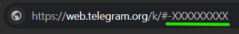

# Prerequisites

Everything you need before the first setup step: hardware, accounts, tools, and the secrets and `.env` values that later pages ask for.

By the end of this page you have:

- Chosen the local or the cloud path.
- Every piece of hardware, every account and every tool for that path.
- The values for the `.env` files and GitHub secrets, ready to paste.

## Needs

Nothing. This is the first page.

## Who

human provides the path, accounts and secrets, and the agent continues.

- Human only: create the accounts, buy the hardware, install tools that need a GUI installer, get the Hugging Face token from the repo owner, create the Telegram bot in BotFather.
- Human provides: the chosen path (local or cloud), `FALL_WEIGHTS_TOKEN`, `TELEGRAM_BOT_TOKEN`, `TELEGRAM_CHAT_GROUP_ID`, and for the local path `POSTGRES_PASSWORD`, `DB_PORT`, `STORAGE_PORT`, `ROOM_ID`, `ROOM_NAME`, the Pi address and the Pi login (see [Local `.env`](#local-env)), the GCP project ID, region and zone (cloud).
- Agent can run: the tool checks in Done when, and writing the `.env` files once the values are given. Never print a secret back.

## Do

### Which path are you on?

Both paths use the same Pi and camera. They differ in where detection and notification run.

| | Local | Cloud |
|---|---|---|
| Detection and notification run on | Your computer, in Docker (`docker compose`) | GKE, deployed by CI and Flux |
| Database and clip storage | Postgres and Supabase storage containers on your computer | Cloud SQL and Cloud Storage |
| Pi reached over | Same LAN | Tailscale |
| Needs | Docker, a computer that stays on | GCP project with billing, Tailscale, GitHub repo admin |

Pick one. Sections marked "local only" or "cloud only" apply to that path alone. Everything else applies to both.

### Hardware

#### Raspberry Pi kit

##### Raspberry Pi

Used: Raspberry Pi 3. Any Pi with a CSI camera port and a hardware H.264 encoder works.

Photo: a green Raspberry Pi 3 board. The text above is the full requirement.


[Buy](https://www.aliexpress.com/item/32621745026.html?spm=a2g0o.productlist.main.9.7b3c42bdhrKdmx&algo_pvid=be5f88ee-a522-48b4-be04-07881eed7cf0&algo_exp_id=be5f88ee-a522-48b4-be04-07881eed7cf0-8&pdp_ext_f=%7B%22order%22%3A%22105%22%2C%22eval%22%3A%221%22%2C%22fromPage%22%3A%22search%22%7D&pdp_npi=6%40dis%21SGD%21234.79%2160.34%21%21%21175.66%2145.14%21%402140ec2d17934180310293152e1069%2159357095308%21sea%21SG%210%21ABX%211%210%21n_tag%3A-29910%3Bd%3A229c8260%3Bm03_new_user%3A-29895%3BpisId%3A5000000220781513&curPageLogUid=USluZf8CrMHE&utparam-url=scene%3Asearch%7Cquery_from%3A%7Cx_object_id%3A32621745026%7C_p_origin_prod%3A)

##### Camera module

Used: IR-CUT camera module. Any CSI camera supported by `rpicamera` works.

Photo: a small camera board with a ribbon cable and an IR-CUT lens. The text above is the full requirement.


[Buy](https://www.aliexpress.com/item/1005004646469525.html?src=google&src=google&albch=shopping&acnt=615-992-9880&isdl=y&slnk=&plac=&mtctp=&albbt=Google_7_shopping&aff_platform=google&aff_short_key=_oFgTQeV&gclsrc=aw.ds&albagn=888888&ds_e_adid=&ds_e_matchtype=&ds_e_device=c&ds_e_network=x&ds_e_product_group_id=&ds_e_product_id=en1005004646469525&ds_e_product_merchant_id=5853250165&ds_e_product_country=SG&ds_e_product_language=en&ds_e_product_channel=online&ds_e_product_store_id=&ds_url_v=2&albcp=23852500233&albag=&isSmbAutoCall=false&needSmbHouyi=false&gad_source=1&gad_campaignid=23857815578&gbraid=0AAAAA_TvRHrcETw6ijqTZyZSOvfc9EeUg&gclid=CjwKCAjwgJHXBhBGEiwAHohJq1M3JjQvFf-zXR9FS4cX3PLYgE6IODys3BzRDtYxqjOp4tgnk_OawxoCuREQAvD_BwE)


#### Your computer

Any machine that runs Docker.

- Local path: runs the detection and notification containers through docker-compose.
- Cloud path: only used for admin (`gcloud`, `kubectl`, `flux`, `tofu`). Detection runs on GKE.

Requirements:

- OS: Windows 11, macOS or Linux.
- CPU and RAM:
  - Local path: at least 4 CPU cores and 8 GB RAM
  - Cloud path: any machine that runs the admin tools and services. We recommend and use the `c3-standard-4`
- Free disk: 20 GB for the local path (Docker images and volumes). This is an estimate, not a measured figure.
- Network: must reach the Pi on port 8554. Same LAN for the local path, Tailscale for the cloud path.

### Accounts

#### GitHub

Needed for: repo access, CI/CD (cloud path). Repo admin rights are required to set secrets and variables.

[Sign up](https://github.com/signup)

#### Hugging Face

No account needed. The model weights are in a private Hugging Face repo. Get the read token `FALL_WEIGHTS_TOKEN` from the repo owner. It goes in `services/detection/.env` as `FALL_WEIGHTS_TOKEN=hf_xxx`, and in the GitHub secret of the same name for the cloud path.

#### Telegram

Needed for: fall alerts. Two values: `TELEGRAM_BOT_TOKEN` and `TELEGRAM_CHAT_GROUP_ID`.

##### Bot token

Create a bot with BotFather and copy its token. Follow the video up to 1:47: [here](https://www.youtube.com/watch?v=MJTllUVLrvk)

##### Chat group ID

1. Open [Telegram Web](https://web.telegram.org).
2. Click the group.
3. Copy the number at the end of the URL in the address bar.

Screenshot: Telegram Web with the group open. The group ID is the number at the end of the address bar URL.




#### Supabase

No account needed. Local path only: compose runs Supabase storage itself. On the cloud path leave all three keys as `unused`.

Generate three values and put them in `.env`:

1. `SUPABASE_JWT_SECRET`: a random string of at least 32 characters, for example `openssl rand -hex 32`.
2. `SUPABASE_ANON_KEY`: a JWT signed (HS256) with `SUPABASE_JWT_SECRET`, payload `{"role": "anon"}`.
3. `SUPABASE_SERVICE_KEY`: a JWT signed (HS256) with `SUPABASE_JWT_SECRET`, payload `{"role": "service_role"}`.

Build the two JWTs at [jwt.io](https://jwt.io): pick HS256, paste the payload, paste the secret. An agent must not paste a secret into a website. It builds them locally instead:

```bash
export JWT_SECRET=<SUPABASE_JWT_SECRET>
python -c "import jwt,os; print(jwt.encode({'role': 'anon'}, os.environ['JWT_SECRET'], algorithm='HS256'))"
```

This needs `pip install pyjwt==2.8.0`. The secret goes through an environment variable so it stays out of the command line. Do not paste the output anywhere but `.env`. Run it again with `service_role` for the service key.

#### GCP (cloud only)

Needed for: GKE, Artifact Registry, Cloud Storage and Cloud SQL. Create a project with billing enabled.

#### Tailscale (cloud only)

Needed for: letting the cluster reach the Pi's RTSP stream.

[Sign up](https://tailscale.com)

### Tools

#### All paths

- [Git](https://git-scm.com/downloads)
- SSH client. Built into Windows 11, macOS and Linux.
- [Raspberry Pi Imager](https://www.raspberrypi.com/software/), to flash the microSD card.
- [FFmpeg](https://ffmpeg.org/download.html), for `ffprobe`, which checks the camera stream.
- A text editor, to fill in `.env`.

#### Local only

- [Docker Desktop](https://docs.docker.com/desktop/) with Compose v2. Check with `docker compose version`.

Only if you run services outside Docker:

- [Python](https://www.python.org/downloads/) 3.12
- [JDK](https://adoptium.net) 21
- [Maven](https://maven.apache.org/download.cgi)

#### Cloud only

- [gcloud](https://cloud.google.com/sdk/docs/install)
- kubectl and the GKE auth plugin, installed through gcloud:

  ```bash
  gcloud components install kubectl gke-gcloud-auth-plugin
  ```
- [flux](https://fluxcd.io/flux/installation/)
- [OpenTofu](https://opentofu.org/docs/intro/install/) 1.13 or newer
- [Tailscale client](https://tailscale.com/download)
- [Helm](https://helm.sh/docs/intro/install/), to install the Tailscale operator.
- [GitHub CLI](https://cli.github.com) (optional), to set secrets and variables from the terminal.

### Secrets and variables

#### GitHub secrets and variables (CLOUD PATH ONLY)

Set them in the repo under Settings, Secrets and variables, Actions. The image workflow reads them to build, push to Artifact Registry and authenticate to GCP.

The names, types and values are in [GitHub secrets and variables](../env-vars.md#github-secrets-and-variables). The refit secrets are optional there too.

`GCP_SERVICE_ACCOUNT` and `GCP_WIF_PROVIDER` do not exist yet on a fresh project. Create them in [GCP auth and registry](../04-ci-cd-bootstrap/02-gcp-auth-and-registry.md), then come back and set them.

#### Local `.env`

Local path only. Two files, both gitignored.

##### `.env` in the repo root

Copy `.env.example.local` to `.env` and replace every `{INSERT...}` placeholder. What to put in each variable is in [Notification](../env-vars.md#notification), the Local column.

##### `services/detection/.env`

Copy `services/detection/.env.example` to `.env`. What to put in each variable is in [Detection](../env-vars.md#detection), the Local column. Set `MEDIAMTX_HOST`, `STREAM_USERNAME` and `STREAM_PASSWORD` from the Pi you set up in [Pi camera](../02-pi-camera/README.md).

## Done when

Read-only. Shell: bash or PowerShell, the commands are the same.

```bash
git --version
docker compose version
```

Local path: both print a version, and `docker compose version` says v2 or newer.

Cloud path: also run

```bash
gcloud version
kubectl version --client
flux --version
tofu version
helm version
```

Each prints a version. `tofu version` is 1.13 or newer.

## If it fails

- [Troubleshooting index](../troubleshooting.md)
