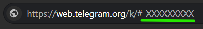

# Prerequisites

## Which path are you on?

## Hardware

### Raspberry Pi kit

#### Raspberry Pi

Used: Raspberry Pi 3. Any Pi with a CSI camera port and a hardware H.264 encoder works.

[Buy](https://www.aliexpress.com/item/32621745026.html?spm=a2g0o.productlist.main.9.7b3c42bdhrKdmx&algo_pvid=be5f88ee-a522-48b4-be04-07881eed7cf0&algo_exp_id=be5f88ee-a522-48b4-be04-07881eed7cf0-8&pdp_ext_f=%7B%22order%22%3A%22105%22%2C%22eval%22%3A%221%22%2C%22fromPage%22%3A%22search%22%7D&pdp_npi=6%40dis%21SGD%21234.79%2160.34%21%21%21175.66%2145.14%21%402140ec2d17934180310293152e1069%2159357095308%21sea%21SG%210%21ABX%211%210%21n_tag%3A-29910%3Bd%3A229c8260%3Bm03_new_user%3A-29895%3BpisId%3A5000000220781513&curPageLogUid=USluZf8CrMHE&utparam-url=scene%3Asearch%7Cquery_from%3A%7Cx_object_id%3A32621745026%7C_p_origin_prod%3A)

#### Camera module

Used: IR-CUT camera module. Any CSI camera supported by `rpicamera` works.

[Buy](https://www.aliexpress.com/item/1005004646469525.html?src=google&src=google&albch=shopping&acnt=615-992-9880&isdl=y&slnk=&plac=&mtctp=&albbt=Google_7_shopping&aff_platform=google&aff_short_key=_oFgTQeV&gclsrc=aw.ds&albagn=888888&ds_e_adid=&ds_e_matchtype=&ds_e_device=c&ds_e_network=x&ds_e_product_group_id=&ds_e_product_id=en1005004646469525&ds_e_product_merchant_id=5853250165&ds_e_product_country=SG&ds_e_product_language=en&ds_e_product_channel=online&ds_e_product_store_id=&ds_url_v=2&albcp=23852500233&albag=&isSmbAutoCall=false&needSmbHouyi=false&gad_source=1&gad_campaignid=23857815578&gbraid=0AAAAA_TvRHrcETw6ijqTZyZSOvfc9EeUg&gclid=CjwKCAjwgJHXBhBGEiwAHohJq1M3JjQvFf-zXR9FS4cX3PLYgE6IODys3BzRDtYxqjOp4tgnk_OawxoCuREQAvD_BwE)

#### Power supply

Use the official supply for your Pi model. An undervolted Pi causes encoder errors.

#### microSD card

To store and flash the OS for the Raspberry Pi

### Your computer

Any machine that runs Docker.

- Local path: runs the detection and notification containers through docker-compose.
- Cloud path: only used for admin (`gcloud`, `kubectl`, `flux`, `tofu`). Detection runs on GKE.

Requirements:

- OS: Windows 11, macOS or Linux.
- CPU, RAM and free disk: TODO (YOLO inference plus Postgres and Supabase containers).
- Network: must reach the Pi on port 8554. Same LAN for the local path, Tailscale for the cloud path.

## Accounts

### GitHub

Needed for: repo access, CI/CD (cloud path). Repo admin rights are required to set secrets and variables.

[Sign up](https://github.com/signup)

### Hugging Face

No account needed. The model weights are in a private Hugging Face repo. Get the read token `FALL_WEIGHTS_TOKEN` from the repo owner. It goes in `services/detection/.env` as `FALL_WEIGHTS_TOKEN=hf_xxx`, and in the GitHub secret of the same name for the cloud path.

### Telegram

Needed for: fall alerts. Two values: `TELEGRAM_BOT_TOKEN` and `TELEGRAM_CHAT_GROUP_ID`.

#### Bot token

Create a bot with BotFather and copy its token. Follow the video up to 1:47: [here](https://www.youtube.com/watch?v=MJTllUVLrvk)

#### Chat group ID

1. Open [Telegram Web](https://web.telegram.org).
2. Click the group.
3. Copy the number at the end of the URL in the address bar.

### Supabase

No account needed. Local path only: compose runs Supabase storage itself. On the cloud path leave all three keys as `unused`.

Generate three values and put them in `.env`:

1. `SUPABASE_JWT_SECRET`: a random string of at least 32 characters, for example `openssl rand -hex 32`.
2. `SUPABASE_ANON_KEY`: a JWT signed (HS256) with `SUPABASE_JWT_SECRET`, payload `{"role": "anon"}`.
3. `SUPABASE_SERVICE_KEY`: a JWT signed (HS256) with `SUPABASE_JWT_SECRET`, payload `{"role": "service_role"}`.

Build the two JWTs at [jwt.io](https://jwt.io): pick HS256, paste the payload, paste the secret.

### GCP (cloud only)

Needed for: GKE, Artifact Registry, Cloud Storage and Cloud SQL. Create a project with billing enabled.

### Tailscale (cloud only)

Needed for: letting the cluster reach the Pi's RTSP stream.

[Sign up](https://tailscale.com)

## Tools

### All paths

- [Git](https://git-scm.com/downloads)
- SSH client. Built into Windows 11, macOS and Linux.
- [Raspberry Pi Imager](https://www.raspberrypi.com/software/), to flash the microSD card.
- A text editor, to fill in `.env`.

### Local only

- [Docker Desktop](https://docs.docker.com/desktop/) with Compose v2. Check with `docker compose version`.

Only if you run services outside Docker:

- [Python](https://www.python.org/downloads/) 3.12
- [JDK](https://adoptium.net) 21
- [Maven](https://maven.apache.org/download.cgi)

### Cloud only

- [gcloud](https://cloud.google.com/sdk/docs/install)
- [kubectl](https://kubernetes.io/docs/tasks/tools/)
- [flux](https://fluxcd.io/flux/installation/)
- [OpenTofu](https://opentofu.org/docs/intro/install/) 1.13 or newer
- [Tailscale client](https://tailscale.com/download)
- [GitHub CLI](https://cli.github.com) (optional), to set secrets and variables from the terminal.

## Secrets and variables

### GitHub secrets and variables (CLOUD PATH ONLY)

Set them in the repo under Settings, Secrets and variables, Actions. The image workflow reads them to build, push to Artifact Registry and authenticate to GCP.

| Name | Type | Value |
|------|------|-------|
| `FALL_WEIGHTS_TOKEN` | Secret | Hugging Face read token from the repo owner |
| `GCP_PROJECT_ID` | Variable | Your GCP project ID |
| `GCP_REGION` | Variable | Artifact Registry region, for example `asia-southeast1` |
| `GCP_SERVICE_ACCOUNT` | Variable | Email of the service account CI impersonates |
| `GCP_WIF_PROVIDER` | Variable | Full resource name of the Workload Identity provider |

The images are pushed to `<GCP_REGION>-docker.pkg.dev/<GCP_PROJECT_ID>/bbfc-registry/<service>`. The Artifact Registry repo must be named `bbfc-registry`.

`GCP_SERVICE_ACCOUNT` and `GCP_WIF_PROVIDER` do not exist yet on a fresh project. Create them in [GCP auth and registry](../04-ci-cd-bootstrap/02-gcp-auth-and-registry.md), then come back and set them.

### Local `.env`

Local path only. Two files, both gitignored.

#### `.env` in the repo root

Copy `.env.example.local` to `.env` and replace every `{INSERT...}` placeholder.

| Name | Value |
|------|-------|
| `COMPOSE_PROFILES` | Keep `local` |
| `POSTGRES_PASSWORD` | Any password you choose |
| `TELEGRAM_BOT_TOKEN` | [Bot token](#bot-token) |
| `TELEGRAM_CHAT_GROUP_ID` | [Chat group ID](#chat-group-id) |
| `SUPABASE_JWT_SECRET`, `SUPABASE_ANON_KEY`, `SUPABASE_SERVICE_KEY` | [Generated in the Supabase section](#supabase) |
| `DB_PORT` | Free port on your machine for Postgres |
| `STORAGE_PORT` | Free port on your machine for Supabase storage |
| `STORAGE_FILE_SIZE_LIMIT` | Keep `8388608` (8 MB) |

#### `services/detection/.env`

Copy `services/detection/.env.example` to `.env`.

| Name | Value |
|------|-------|
| `ROOM_ID`, `ROOM_NAME` | Any label for the room the camera watches |
| `NOTIFICATION_BASE_URL` | Keep the default. It is the compose hostname of the notification service. |
| `MEDIAMTX_HOST` | IP address of the Pi |
| `STREAM_USERNAME`, `STREAM_PASSWORD` | Credentials set on the Pi's MediaMTX in [Pi camera](../02-pi-camera/README.md) |
| `FALL_WEIGHTS_TOKEN` | [Hugging Face read token](#hugging-face) |
| `ALLOW_MANUAL_RECORDING` | Keep `0` |
| `VID_STRIDE`, `STREAM_FRAME_STRIDE`, `BUFFER_LEN`, `FALL_CLEAR_WINDOWS`, `EVENT_COOLDOWN_SEC` | Keep the defaults. They are tuned for a 15 fps camera. |

Every other detection setting has a working default.
