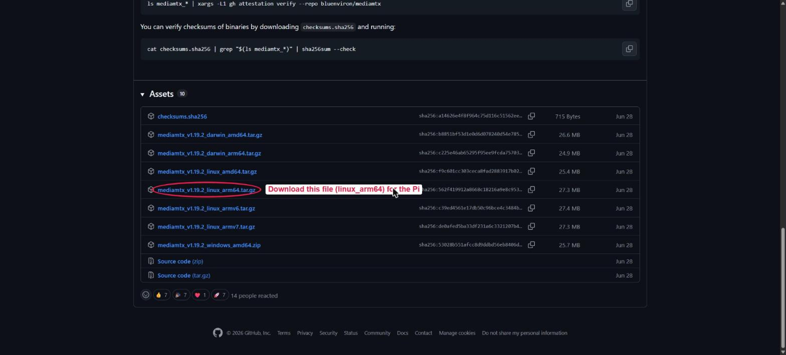

# Pi Camera Setup

The Pi only streams the camera. It runs MediaMTX, which serves the camera as an RTSP stream on port 8554, path `cam`. Detection runs elsewhere and reads that stream.

By the end of this page you have:

- A camera that shows up on the Pi.
- MediaMTX serving `rtsp://<user>:<password>@<pi-address>:8554/cam`.
- MediaMTX starting on every boot.
- The Pi reachable over SSH from any network through Tailscale (cloud path only).

Needs: the [Raspberry Pi kit](../01-prerequisites/README.md#raspberry-pi-kit) and the [Tailscale account](../01-prerequisites/README.md#tailscale-cloud-only) for the cloud path.

## 1. Flash the OS

You need the microSD card, a card reader and [Raspberry Pi Imager](https://www.raspberrypi.com/software/). Flashing erases everything on the card. For screenshots of each Imager screen, see [Raspberry Pi's getting started guide](https://www.raspberrypi.com/documentation/computers/getting-started.html#imager-install).

1. Put the microSD card in the card reader and plug it into your computer.
2. Open Raspberry Pi Imager.
3. Choose device: pick your Pi model (this guide used Raspberry Pi 3).
4. Choose OS: Raspberry Pi OS (other), then **Raspberry Pi OS Full (64-bit)**. The MediaMTX build in step 5 is `arm64`, so 32-bit will not work. The `rpicam-*` commands in step 3 need Raspberry Pi OS Bookworm or newer.
5. Choose storage: pick the microSD card. Check the size, so you do not pick another drive.
6. Click Next, then edit the OS customisation settings:

| Setting | Value |
|---------|-------|
| Hostname | Any name, for example `wyhrp0`. You use it to SSH in. |
| Username and password | Your own. This is the `{DEVICE_NAME}` user in step 7. |
| Wi-Fi | Your network name and password. Skip if the Pi uses an Ethernet cable. A Pi 3B only joins 2.4 GHz networks. |
| Locale | Your time zone and keyboard layout |
| Services | Enable SSH. Use password authentication, or paste your public key. |

7. Save, then confirm the write. Wait for Imager to finish writing and verifying.
8. Take the card out and put it in the Pi.
9. Connect the camera first ([step 2](#2-connect-the-camera)), then power the Pi on. Wait about two minutes for the first boot.
10. From your computer, SSH in:

```bash
ssh <username>@<hostname>.local
```

If `<hostname>.local` does not resolve, find the Pi's IP address on your router's device list and use `ssh <username>@<ip-address>`.

Keep this SSH session open. Every command from step 3 on runs on the Pi.

<!--  -->

## 2. Connect the camera

Power the Pi off, then follow [Getting started with the Camera Module](https://projects.raspberrypi.org/en/projects/getting-started-with-picamera/2) to connect the camera.

<!--  -->

## 3. Check the camera works

Boot the Pi and SSH in. Then run:

```bash
rpicam-hello --list-cameras
rpicam-hello -t 0
```

- `--list-cameras` prints the cameras the Pi found, numbered from `0`. The list must not be empty before you go on.
- `-t 0` opens a live preview until you stop it. It needs a screen on the Pi. Over SSH only the first command is useful.

## 4. Reach the Pi from any network

Cloud path: required. The GKE cluster reaches the Pi through Tailscale.
Local path: optional. Your machine and the Pi share a LAN, so the LAN address is enough.

Install Tailscale on the Pi:

```bash
curl -fsSL https://tailscale.com/install.sh | sh
```

Join your tailnet:

```bash
sudo tailscale up
```

It prints a login URL. Open it in a browser on any device and sign in with the account from [Tailscale](../01-prerequisites/README.md#tailscale-cloud-only). The Pi then appears in the machine list of the Tailscale admin console.

Read the Pi's Tailscale address (`100.x.x.x`) with:

```bash
tailscale ip -4
```

Use this address as `MEDIAMTX_HOST` on the cloud path.

<!--  -->

## 5. Install MediaMTX

```bash
cd ~
mkdir mediamtx
cd mediamtx
wget -c https://github.com/bluenviron/mediamtx/releases/download/v1.19.2/mediamtx_v1.19.2_linux_arm64.tar.gz -O - | sudo tar -xz
```

This unpacks the `mediamtx` binary and a default `mediamtx.yml` into `~/mediamtx`.

For more detail, see [Streaming with MediaMTX](https://www.raspberrypi.com/documentation/accessories/camera-software.html#streaming-with-mediamtx) in the Raspberry Pi documentation. To use a newer version, take the `linux_arm64` file from the [MediaMTX releases](https://github.com/bluenviron/mediamtx/releases) and replace the version in the URL above. This guide was tested with `v1.19.2`.



## 6. Configure MediaMTX

Edit the config:

```bash
sudo nano ~/mediamtx/mediamtx.yml
```

Set these top-level keys. Each one already exists in the default file, so find it and change its value:

```yaml
logLevel: info
writeQueueSize: 2048
```

Set the camera path under `paths:`. Add it next to the existing entries and keep them:

```yaml
paths:
  cam:
    source: rpiCamera
    rpiCameraWidth: 1280
    rpiCameraHeight: 720
    rpiCameraFPS: 15
    rpiCameraBitrate: 2000000
    rpiCameraIDRPeriod: 30
```

Do not lower `rpiCameraBitrate` below `1000000`: an under-fed encoder is what wedges it. The detection service is tuned for 15 fps.

Add a user that may read the stream to the existing `authInternalUsers:` list. These are the `STREAM_USERNAME` and `STREAM_PASSWORD` that [`services/detection/.env`](../01-prerequisites/README.md#servicesdetectionenv) needs:

```yaml
authInternalUsers:
  - user: <STREAM_USERNAME>
    pass: <STREAM_PASSWORD>
    ips: []
    permissions:
      - action: read
        path: cam
      - action: playback
        path: cam
```

Choose your own username and password. Do not commit them anywhere.

## 7. Start MediaMTX on boot

Create the service file:

```bash
sudo nano /etc/systemd/system/mediamtx.service
```

Replace `{DEVICE_NAME}` with the Pi's username:

```ini
[Unit]
Description=MediaMTX RTSP server
After=network.target

[Service]
ExecStart=/home/{DEVICE_NAME}/mediamtx/mediamtx /home/{DEVICE_NAME}/mediamtx/mediamtx.yml
Restart=always
RestartSec=5

[Install]
WantedBy=multi-user.target
```

Load it, start it and enable it on boot:

```bash
sudo systemctl daemon-reload
sudo systemctl restart mediamtx
sudo systemctl enable mediamtx.service
sudo systemctl status mediamtx
```

- `daemon-reload` makes systemd re-read the service files.
- `restart mediamtx` restarts only this service.
- `status` must show `active (running)`.

To follow the live log:

```bash
sudo journalctl -u mediamtx.service -f
```

<!--  -->

## 8. Confirm the stream works

Reboot the Pi so you also test the start on boot:

```bash
sudo reboot
```

Wait about a minute. Then, from your computer, read the stream. `<pi-address>` is the Pi's LAN address on the local path, or its `100.x.x.x` Tailscale address on the cloud path (your computer must be on the same tailnet):

```bash
ffprobe rtsp://<STREAM_USERNAME>:<STREAM_PASSWORD>@<pi-address>:8554/cam
```

The page works when `ffprobe` lists a `Video: h264` stream at `1280x720`. To see the picture, open the same URL in VLC (Media > Open Network Stream).

## Next

- Local path: [Local deployment](../03-local/README.md)
- Cloud path: [CI/CD bootstrap](../04-ci-cd-bootstrap/01-github-repo-setup.md)
