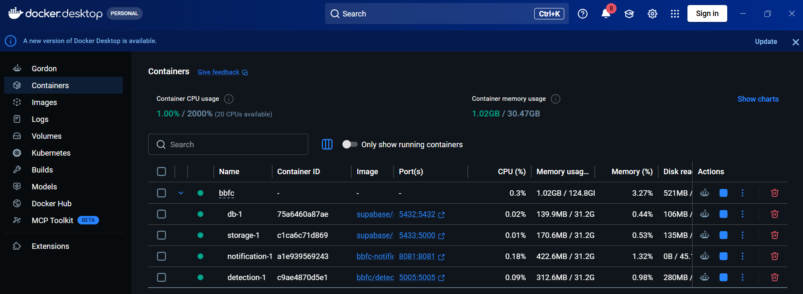
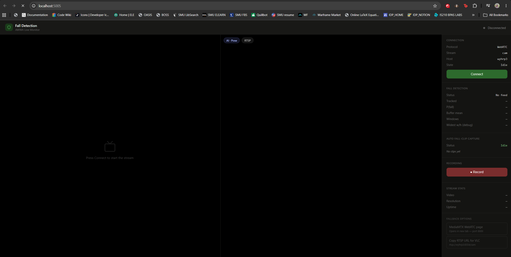
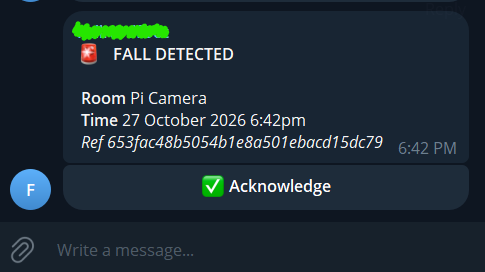

# Local Deployment

Everything except the camera runs on your computer through docker-compose: Postgres, Supabase storage, the notification service and the detection service. The detection service reads the Pi's RTSP stream over your LAN.

By the end of this page you have:

- Four containers running: `db`, `storage`, `notification` and `detection`.
- The detection page open at `http://localhost:5005`, showing the live camera.
- A Telegram alert when a fall is detected.

Needs: the finished [Pi camera](../02-pi-camera/README.md) page, and everything under [Local only](../01-prerequisites/README.md#local-only) in the prerequisites.

## 1. Get the code

```bash
git clone https://github.com/WongYH01/BBFC-FallDetectionSystem.git
cd BBFC-FallDetectionSystem
```

TODO: confirm the clone URL.

## 2. Fill in the two `.env` files

Follow [Local `.env`](../01-prerequisites/README.md#local-env) in the prerequisites. You end with:

- `.env` in the repo root, copied from `.env.example.local`.
- `services/detection/.env`, copied from `services/detection/.env.example`.

Copy them:

```bash
cp .env.example.local .env
cp services/detection/.env.example services/detection/.env
```

Replace every `{INSERT...}` placeholder in `.env`. In `services/detection/.env` set `MEDIAMTX_HOST` to the Pi's LAN address, and `STREAM_USERNAME` and `STREAM_PASSWORD` to the values you chose in [Configure MediaMTX](../02-pi-camera/README.md#6-configure-mediamtx).

## 3. Check the Pi stream

Before you start the containers, check that your computer reaches the stream. Replace the four placeholders:

```bash
ffprobe rtsp://<STREAM_USERNAME>:<STREAM_PASSWORD>@<MEDIAMTX_HOST>:8554/cam
```

It prints the stream details: `Video: h264`, `1280x720`. If it hangs or fails, fix that first: see [Troubleshooting](#troubleshooting).

TODO: `ffprobe` ships with FFmpeg. Decide whether to add FFmpeg to the prerequisites or use VLC (Media, Open Network Stream) instead.

## 4. Start the stack

From the repo root:

```bash
docker compose up -d --build
```

The first build is slow. The detection image downloads the model weights from Hugging Face during the build, using `FALL_WEIGHTS_TOKEN` from `services/detection/.env`. You do not download the weights yourself.

`COMPOSE_PROFILES=local` in `.env` makes compose start all four services. Check them:

```bash
docker compose ps
```

All four must show `running`. `notification` must also show `healthy`: `detection` waits for it.

<!--  -->

If you use Docker Desktop, open the Containers tab. The `bbfc` group lists the same four services as shown below:




## 5. Open the detection page

Open `http://localhost:5005`. You should see the live camera feed.

This page is for developers only. It is not the view for normal users or caregivers: they receive alerts in Telegram and never open this page. Use it to check that the camera, the stream and the detection work.

The page has no login. Compose publishes it on `127.0.0.1` only, so only your own computer reaches it.



TODO: describe what the page shows (status, skeleton overlay).

## 6. Check an alert reaches Telegram

Send a test alert to the notification service with [Postman](https://www.postman.com/downloads/). You do not need to fall.

1. Create a new request.
2. Set the method to `POST` and the URL to `http://localhost:8081/api/v1/notification/events`.
3. Open Body, choose `raw`, set the type to `JSON` and paste:

```json
{
  "eventId": "test-001",
  "roomId": "room-1",
  "roomName": "Ward 3B",
  "confidence": 0.92
}
```

4. Click Send.

- Status `202` with `"status": "accepted"` means the alert was created. The Telegram group receives a message within a few seconds.
- Status `200` with `"status": "duplicate"` means the `eventId` was already used. Change `eventId` (for example `test-002`) and send again.
- Status `400` means a field is missing or empty, or `confidence` is outside 0 to 1.



## Daily use

| Task | Command |
|------|---------|
| Follow the detection log | `docker compose logs -f detection` |
| Follow the notification log | `docker compose logs -f notification` |
| Stop, keep data | `docker compose down` |
| Start again, no rebuild | `docker compose up -d` |
| Stop and delete the database and clips | `docker compose down -v` |
| Rebuild after a code change | `docker compose up -d --build` |

`down -v` deletes the database and all stored clips. There is no undo.

The detection service has `restart: unless-stopped`, so it comes back after a Docker restart.

## Ports

| Port | Service | Reachable from |
|------|---------|----------------|
| 5005 | Detection page | This computer only |
| 8081 | Notification API | This computer only |
| `DB_PORT` | Postgres | This computer only |
| `STORAGE_PORT` | Supabase storage | This computer only |

## Troubleshooting

TODO:

- `docker compose up` fails with `variable is not set`: a `.env` value is missing.
- The detection build fails to download the weights: wrong or missing `FALL_WEIGHTS_TOKEN`.
- The detection page shows no video: wrong `MEDIAMTX_HOST` or stream credentials, or the Pi is on another network.
- A port is already in use: change `DB_PORT` or `STORAGE_PORT`.
- No Telegram message: bot not added to the group, or wrong `TELEGRAM_CHAT_GROUP_ID`.

## Next

- Run it in production on GCP: [CI/CD bootstrap](../04-ci-cd-bootstrap/01-github-repo-setup.md)
- Day-to-day checks: [Operations](../06-operations/README.md)
