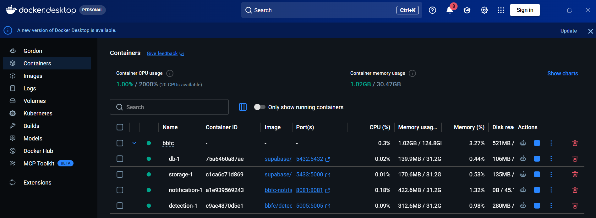
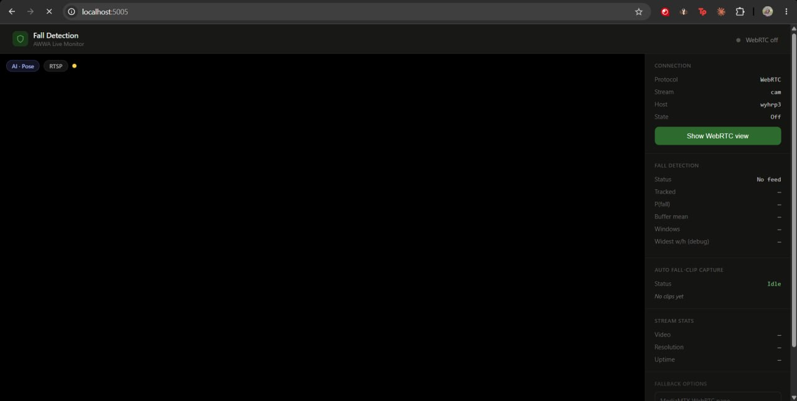
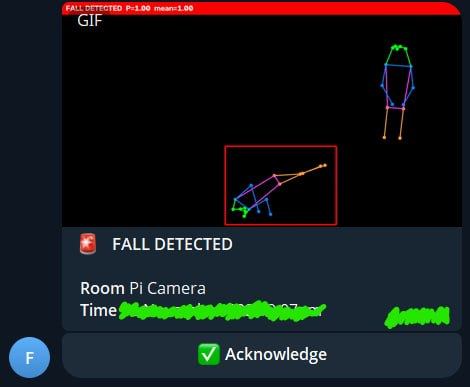

# Local Deployment

Everything except the camera runs on your computer through docker-compose: Postgres, Supabase storage, the notification service and the detection service. The detection service reads the Pi's RTSP stream over your LAN.

By the end of this page you have:

- Four containers running: `db`, `storage`, `notification` and `detection`.
- The detection page open at `http://localhost:5005`, showing the live camera.
- A Telegram alert when a fall is detected.

## Needs

The finished [Pi camera](../02-pi-camera/README.md) page, and everything under [Local only](../01-prerequisites/README.md#local-only) in the prerequisites.

## Who

agent can run, after the human provides the `.env` values.

- Human provides, once: `FALL_WEIGHTS_TOKEN`, `TELEGRAM_BOT_TOKEN`, `TELEGRAM_CHAT_GROUP_ID`, `POSTGRES_PASSWORD`, `DB_PORT`, `STORAGE_PORT`, `ROOM_ID`, `ROOM_NAME`, the Pi's LAN address (`MEDIAMTX_HOST`) and the stream credentials. The agent may generate the three `SUPABASE_*` values itself, after asking. Details are in [Environment variables](../env-vars.md). See [Local `.env`](../01-prerequisites/README.md#local-env). Never print or commit them.
- Agent can run: everything on this page. Ask first before `docker compose down -v`: it deletes the database and the clips.
- Human only: reading the Telegram group to confirm the alert arrived.

Shell: bash for the commands, with PowerShell variants where they differ.

## Do

### 1. Get the code

Skip this step if you are already inside a clone of the repo.

```bash
git clone https://github.com/WongYH01/BBFC-FallDetectionSystem.git
cd BBFC-FallDetectionSystem
```

### 2. Fill in the two `.env` files

Follow [Local `.env`](../01-prerequisites/README.md#local-env) in the prerequisites. You end with:

- `.env` in the repo root, copied from `.env.example.local`.
- `services/detection/.env`, copied from `services/detection/.env.example`.

Copy them:

```bash
cp .env.example.local .env
cp services/detection/.env.example services/detection/.env
```

Replace every `{INSERT...}` placeholder in `.env`. In `services/detection/.env` set `MEDIAMTX_HOST` to the Pi's LAN address, and `STREAM_USERNAME` and `STREAM_PASSWORD` to the values you chose in [Configure MediaMTX](../02-pi-camera/README.md#6-configure-mediamtx).

### 3. Start the stack

From the repo root:

```bash
docker compose up -d --build
```

The first build is slow. The detection image downloads the model weights from Hugging Face during the build, using `FALL_WEIGHTS_TOKEN` from `services/detection/.env`. You do not download the weights yourself.

`COMPOSE_PROFILES=local` in `.env` makes compose start all four services. Check them:

```bash
docker compose ps
```

All four must show `running`. `notification` must also show `healthy`: `detection` waits for it.

If you use Docker Desktop, open the Containers tab. The `bbfc` group lists the same four services as shown below:



### 4. Open the detection page

Open `http://localhost:5005`. You should see the live camera feed.

This page is for developers only. It is not the view for normal users or caregivers: they receive alerts in Telegram and never open this page. Use it to check that the camera, the stream and the detection work.

The page has no login. Compose publishes it on `127.0.0.1` only, so only your own computer reaches it.

The pose overlay draws a skeleton on each person in the frame. A fall panel shows the current fall state. A `FALL DETECTED` banner appears when the Fall Decision raises the alarm.



### 5. Check an alert reaches Telegram

Send a test alert to the notification service. You do not need to fall. The Telegram bot must already be a member of the group whose ID is `TELEGRAM_CHAT_GROUP_ID`.

macOS, Linux or Git Bash:

```bash
curl -X POST http://localhost:8081/api/v1/notification/events   -H "Content-Type: application/json"   -d '{"eventId":"test-001","roomId":"room-1","roomName":"Ward 3B","confidence":0.92}'
```

Windows PowerShell:

```powershell
Invoke-RestMethod -Method Post -Uri http://localhost:8081/api/v1/notification/events `
  -ContentType "application/json" `
  -Body '{"eventId":"test-001","roomId":"room-1","roomName":"Ward 3B","confidence":0.92}'
```

The reply is `{"eventId":"test-001","status":"accepted"}` and the Telegram group receives a `FALL DETECTED` message within a few seconds. That message confirms alerts arrive. If you send the same `eventId` again the reply is `duplicate` and no message is sent: change `eventId` (for example `test-002`) to test again.



### Daily use

| Task | Command |
|------|---------|
| Follow the detection log | `docker compose logs -f detection` |
| Follow the notification log | `docker compose logs -f notification` |
| Stop, keep data | `docker compose down` |
| Start again, no rebuild | `docker compose up -d` |
| Stop and delete the database and clips | `docker compose down -v` |
| Rebuild after a code change | `docker compose up -d --build` |

`down -v` deletes the database and all stored clips. There is no undo.

The detection service has `restart: unless-stopped`, so it comes back after a Docker restart.

### Ports

| Port | Service | Reachable from |
|------|---------|----------------|
| 5005 | Detection page | This computer only |
| 8081 | Notification API | This computer only |
| `DB_PORT` | Postgres | This computer only |
| `STORAGE_PORT` | Supabase storage | This computer only |

## Done when

Read-only. Run from the repo root:

```bash
docker compose ps
curl http://localhost:5005/stream/status
```

PowerShell: `Invoke-RestMethod http://localhost:5005/stream/status` (in Windows PowerShell 5.1 `curl` is not curl).

Expected: `db`, `storage`, `notification` and `detection` are `running`, and `notification` is `healthy`. The stream status shows `fps` above `0`. The Telegram group received the `FALL DETECTED` test message.

## If it fails

- [Notification is not healthy](../troubleshooting.md#notification-is-not-healthy)
- [Test alert returns duplicate](../troubleshooting.md#test-alert-returns-duplicate)
- [No Telegram message arrives](../troubleshooting.md#no-telegram-message-arrives)
- [First build is slow](../troubleshooting.md#first-build-is-slow)
- [ffprobe cannot read the stream](../troubleshooting.md#ffprobe-cannot-read-the-stream)

## Next

- Run it in production on GCP: [CI/CD bootstrap](../04-ci-cd-bootstrap/01-github-repo-setup.md)
- Day-to-day checks: [Operations](../06-operations/README.md)
