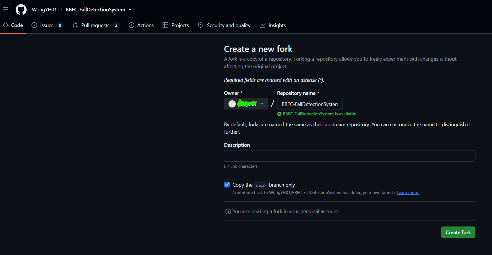
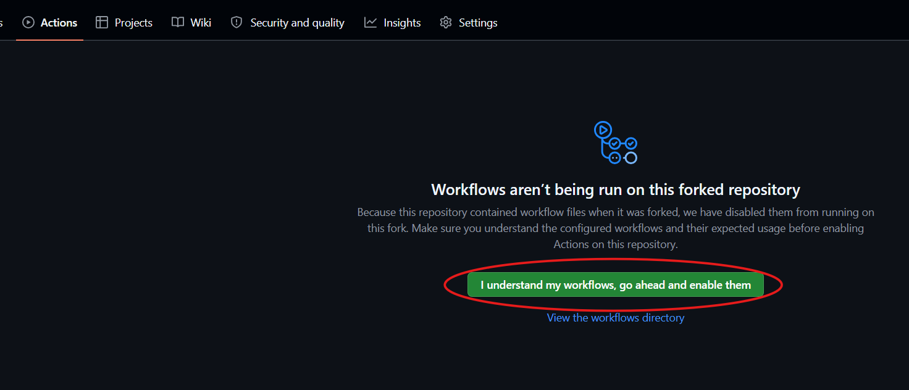

# GitHub Repo Setup

CI/CD runs on GitHub Actions and Flux. Both need a repository that you own and can administer. This page prepares that repository. GCP, Flux and the first pipeline run come in the next pages.

By the end of this page you have:

- Your own fork of the repo, cloned on your computer.
- GitHub Actions enabled on the fork.
- Code scanning and the dependency graph available to the workflows.
- The `FALL_WEIGHTS_TOKEN` secret set.

Needs: a [GitHub account](../01-prerequisites/README.md#github) with admin rights on the fork, and the [Hugging Face token](../01-prerequisites/README.md#hugging-face).

## 1. Fork the repo

1. Open the repo on GitHub and click Fork.
2. Choose your own account as the owner. Keep the repo name.
3. Clone your fork:

```bash
git clone https://github.com/<your-username>/BBFC-FallDetectionSystem.git
cd BBFC-FallDetectionSystem
```

The repo URL is written into the Flux config as `WongYH01/BBFC-FallDetectionSystem` (`infra/flux/flux-system/gotk-sync.yaml`). You do not edit it. `flux bootstrap` rewrites it with your fork's URL in [Flux bootstrap](04-flux-bootstrap.md).

TODO: confirm a fork is the route you want to offer, or also offer a new empty repo.



## 2. Enable GitHub Actions

GitHub disables workflows on a new fork.

1. Open the Actions tab of your fork.
2. Click "I understand my workflows, go ahead and enable them".



You do not need to change Settings, Actions, General, Workflow permissions. Every workflow declares the permissions it needs. No workflow opens pull requests, so leave "Allow GitHub Actions to create and approve pull requests" off.

## 3. Check code scanning and the dependency graph

Two checks in the `ci` workflow fail without these:

- CodeQL and the Trivy image scan upload their results to code scanning. Code scanning is free on a public repo. A private repo needs GitHub Advanced Security.
- `dependency-review` needs the dependency graph. Open Settings, Advanced Security, and make sure Dependency graph is on.

<!--  -->

TODO: confirm the current menu names under Settings, Advanced Security.

## 4. Set the secret

Open Settings, Secrets and variables, Actions, and add:

| Name | Type | Value |
|------|------|-------|
| `FALL_WEIGHTS_TOKEN` | Secret | Your [Hugging Face read token](../01-prerequisites/README.md#hugging-face) |

The image build uses it to download the model weights.

The four `GCP_*` variables are listed in [GitHub secrets and variables](../01-prerequisites/README.md#github-secrets-and-variables-cloud-path-only). Do not set them yet: two of them, `GCP_SERVICE_ACCOUNT` and `GCP_WIF_PROVIDER`, do not exist until [GCP auth and registry](02-gcp-auth-and-registry.md).

<!--  -->

## What you do not do here

- Do not create the `flux-image-updates` branch. Flux creates it when it pushes the first image tag update. You merge that branch into `main` yourself.
- Do not create a deploy key. `flux bootstrap` creates it.
- Do not turn on branch protection on `main` yet. Flux bootstrap pushes to `main`. If you want protection later, require only the `ci / gate` check.

## Troubleshooting

TODO:

- The Actions tab shows no workflows: Actions is still disabled on the fork.
- `upload-sarif` fails: code scanning is unavailable on a private repo without Advanced Security.
- `dependency-review` fails: the dependency graph is off.

## Next

[GCP auth and registry](02-gcp-auth-and-registry.md)
