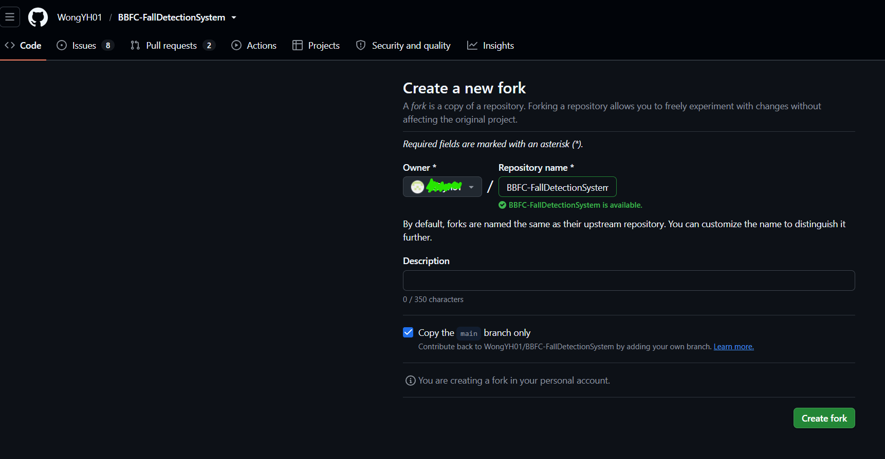
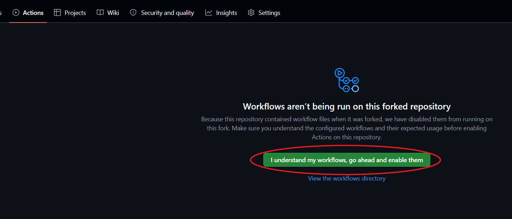
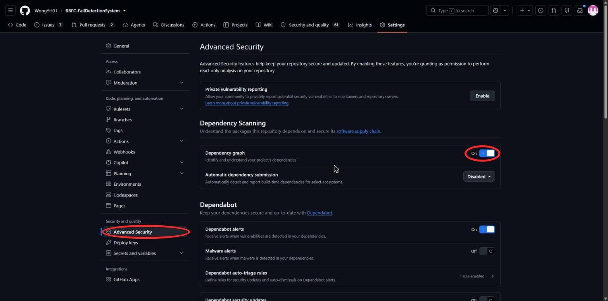

# GitHub Repo Setup

CI/CD runs on GitHub Actions and Flux. Both need a repository that you own and can administer. This page prepares that repository. GCP, Flux and the first pipeline run come in the next pages.

By the end of this page you have:

- Your own fork of the repo, cloned on your computer.
- GitHub Actions enabled on the fork.
- Code scanning and the dependency graph available to the workflows.

## Needs

A [GitHub account](../01-prerequisites/README.md#github) with admin rights on the fork.

## Who

human only for the GitHub console steps, and human provides the fork's GitHub username.

- Human only: Fork, enable Actions, turn on the dependency graph (steps 1 to 3). These are clicks in the GitHub console.
- Human provides: the GitHub username of the fork.

Shell: bash or PowerShell, the commands are the same.

## Do

### 1. Fork the repo

1. Open the repo on GitHub and click Fork.
2. Choose your own account as the owner. Keep the repo name.
3. Clone your fork:

```bash
git clone https://github.com/<your-username>/BBFC-FallDetectionSystem.git
cd BBFC-FallDetectionSystem
```

The repo URL is written into the Flux config as `WongYH01/BBFC-FallDetectionSystem` (`infra/flux/flux-system/gotk-sync.yaml`). You do not edit it. `flux bootstrap` rewrites it with your fork's URL in [Flux bootstrap](04-flux-bootstrap.md).




### 2. Enable GitHub Actions

GitHub disables workflows on a new fork.

1. Open the Actions tab of your fork.
2. Click "I understand my workflows, go ahead and enable them".



You do not need to change Settings, Actions, General, Workflow permissions. Every workflow declares the permissions it needs. No workflow used in this guide opens pull requests, so leave "Allow GitHub Actions to create and approve pull requests" off.

### 3. Check code scanning and the dependency graph

Two checks in the `ci` workflow fail without these:

- CodeQL and the Trivy image scan upload their results to code scanning. Code scanning is free on a public repo. A private repo needs GitHub Advanced Security.
- `dependency-review`, which runs on pull requests, needs the dependency graph. Turn the dependency graph on as below.

1. Open the Settings tab of your fork.
2. Click Advanced Security in the sidebar (it sits under the Security section).


3. Next to Dependency graph, click Enable if it is not already on.

### 4. Secrets and variables

Nothing to set on this page. The image build downloads the model weights from the public [Hugging Face repo](../01-prerequisites/README.md#hugging-face), so it needs no secret.

The four `GCP_*` variables are listed in [GitHub secrets and variables](../env-vars.md#github-secrets-and-variables). Do not set them yet: two of them, `GCP_SERVICE_ACCOUNT` and `GCP_WIF_PROVIDER`, do not exist until [GCP auth and registry](02-gcp-auth-and-registry.md).

### What you do not do here

- Do not create the `flux-image-updates` branch. Flux creates it when it pushes the first image tag update. You merge that branch into `main` yourself.
- Do not create a deploy key. `flux bootstrap` creates it.
- Do not turn on branch protection on `main` yet. Flux bootstrap pushes to `main`. If you want protection later, require only the `ci / gate` check.

## Done when

Read-only:

```bash
gh repo view <your-username>/BBFC-FallDetectionSystem --json isFork,viewerPermission
```

Expected: `"isFork":true` and `"viewerPermission":"ADMIN"`.

## If it fails

- [Code scanning or dependency review fails](../troubleshooting.md#code-scanning-or-dependency-review-fails)

## Next

[GCP auth and registry](02-gcp-auth-and-registry.md)
