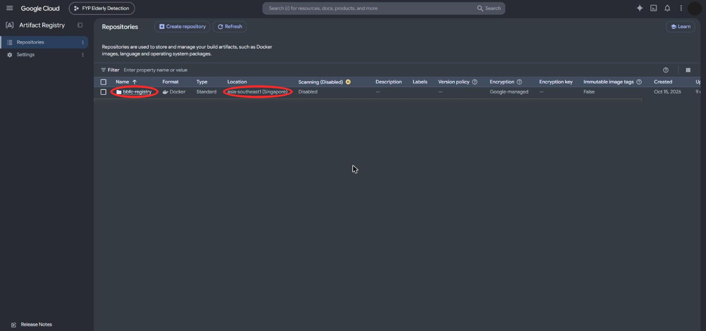
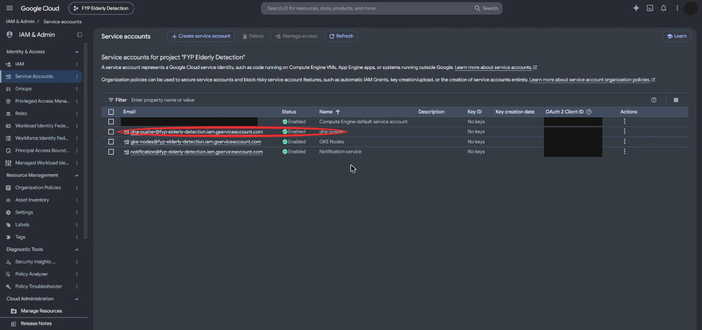
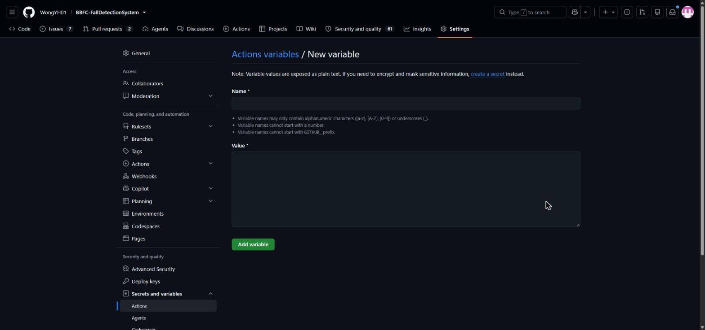

# GCP Auth and Registry

The image workflow pushes to Artifact Registry as a Google service account, and it logs in through Workload Identity Federation, so no key file is stored in GitHub. This page creates the registry, the service account and the federation, then sets the four `GCP_*` variables.

By the end of this page you have:

- An Artifact Registry Docker repo named `bbfc-registry`.
- A service account `gha-pusher` that can push to it.
- A Workload Identity pool and provider that let only your fork authenticate as `gha-pusher`.
- The four `GCP_*` variables set on your fork.

Needs: the finished [GitHub repo setup](01-github-repo-setup.md), a [GCP project](../01-prerequisites/README.md#gcp-cloud-only) with billing enabled, and [gcloud](../01-prerequisites/README.md#cloud-only) installed.

## 1. Log in and pick the project

```bash
gcloud auth login
gcloud config set project <GCP_PROJECT_ID>
```

Set these shell variables. The commands below use them. Use the same region everywhere: the `GCP_REGION` variable and the registry must match.

```bash
export PROJECT_ID=<GCP_PROJECT_ID>
export REGION=<GCP_REGION>            # for example asia-southeast1
export GITHUB_REPO=<your-username>/BBFC-FallDetectionSystem
export PROJECT_NUMBER=$(gcloud projects describe "$PROJECT_ID" --format='value(projectNumber)')
```

On PowerShell, set them with `$env:PROJECT_ID = "..."` and write `$env:PROJECT_ID` where the commands below write `$PROJECT_ID`.

## 2. Enable the APIs

```bash
gcloud services enable artifactregistry.googleapis.com iam.googleapis.com iamcredentials.googleapis.com sts.googleapis.com
```

## 3. Create the registry

The name must be `bbfc-registry`. The workflow and the Flux config both use it.

```bash
gcloud artifacts repositories create bbfc-registry \
  --repository-format=docker \
  --location="$REGION"
```

In the console, open Artifact Registry, Repositories. `bbfc-registry` is listed with format Docker and your region.



The OpenTofu `base` root in the [Cloud pages](../05-cloud/01-provision.md) imports this repo and adds its cleanup policy. Do not add a cleanup policy here.

## 4. Create the service account

The name must be `gha-pusher`. The OpenTofu `base` root refers to it by this name.

```bash
gcloud iam service-accounts create gha-pusher --display-name="GitHub Actions pusher"

gcloud artifacts repositories add-iam-policy-binding bbfc-registry \
  --location="$REGION" \
  --member="serviceAccount:gha-pusher@$PROJECT_ID.iam.gserviceaccount.com" \
  --role=roles/artifactregistry.writer
```

In the console, open IAM & Admin, Service Accounts. `gha-pusher` is listed and enabled.



## 5. Create the Workload Identity pool and provider

The attribute condition lets only your fork authenticate.

```bash
gcloud iam workload-identity-pools create github \
  --location=global \
  --display-name="GitHub"

gcloud iam workload-identity-pools providers create-oidc github \
  --location=global \
  --workload-identity-pool=github \
  --issuer-uri=https://token.actions.githubusercontent.com \
  --attribute-mapping="google.subject=assertion.sub,attribute.repository=assertion.repository" \
  --attribute-condition="assertion.repository=='$GITHUB_REPO'"
```

Allow identities from your fork to impersonate `gha-pusher`:

```bash
gcloud iam service-accounts add-iam-policy-binding \
  "gha-pusher@$PROJECT_ID.iam.gserviceaccount.com" \
  --role=roles/iam.workloadIdentityUser \
  --member="principalSet://iam.googleapis.com/projects/$PROJECT_NUMBER/locations/global/workloadIdentityPools/github/attribute.repository/$GITHUB_REPO"
```

In the console, open IAM & Admin, Workload Identity Federation. The pool `github` is listed with 1 provider.


## 6. Set the GitHub variables

Print the provider's full resource name:

```bash
gcloud iam workload-identity-pools providers describe github \
  --location=global \
  --workload-identity-pool=github \
  --format='value(name)'
```

Open your fork, then Settings, Secrets and variables, Actions, the Variables tab, and add four repository variables:

| Name | Value |
|------|-------|
| `GCP_PROJECT_ID` | `<GCP_PROJECT_ID>` |
| `GCP_REGION` | `<GCP_REGION>` |
| `GCP_SERVICE_ACCOUNT` | `gha-pusher@<GCP_PROJECT_ID>.iam.gserviceaccount.com` |
| `GCP_WIF_PROVIDER` | The output of the previous command, of the form `projects/<project-number>/locations/global/workloadIdentityPools/github/providers/github` |

These are variables, not secrets. Click New repository variable on the Variables tab, enter a name and value, and click Add variable. Repeat for each row.



Or set them with the GitHub CLI:

```bash
gh variable set GCP_PROJECT_ID --repo "$GITHUB_REPO" --body "$PROJECT_ID"
gh variable set GCP_REGION --repo "$GITHUB_REPO" --body "$REGION"
gh variable set GCP_SERVICE_ACCOUNT --repo "$GITHUB_REPO" --body "gha-pusher@$PROJECT_ID.iam.gserviceaccount.com"
gh variable set GCP_WIF_PROVIDER --repo "$GITHUB_REPO" --body "projects/$PROJECT_NUMBER/locations/global/workloadIdentityPools/github/providers/github"
```

## Next

[Workflows](03-workflows.md)
