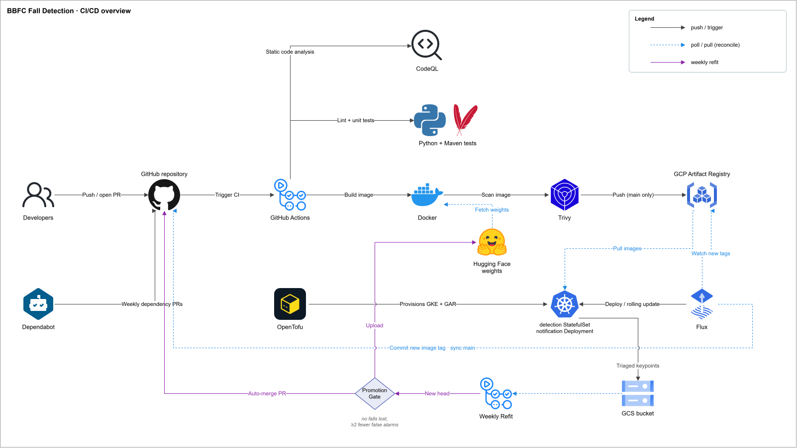
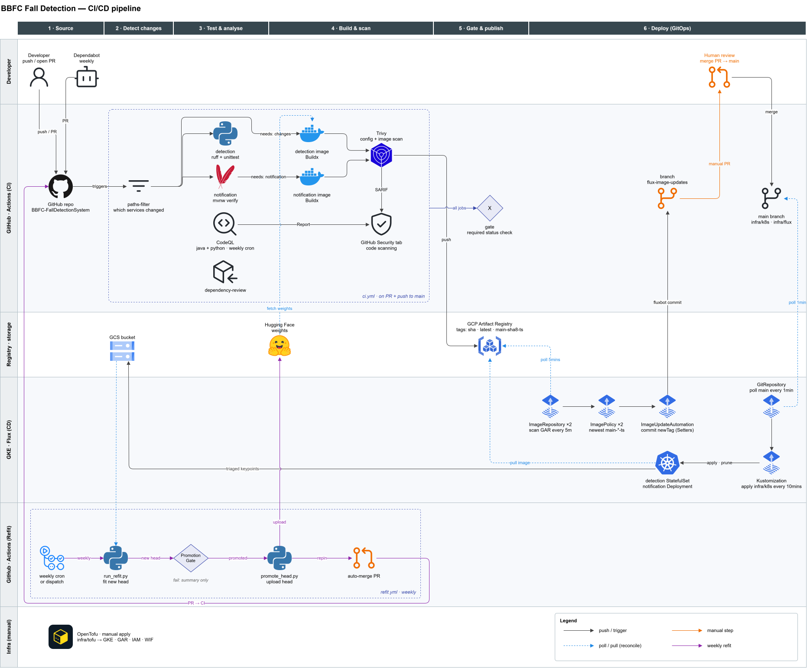
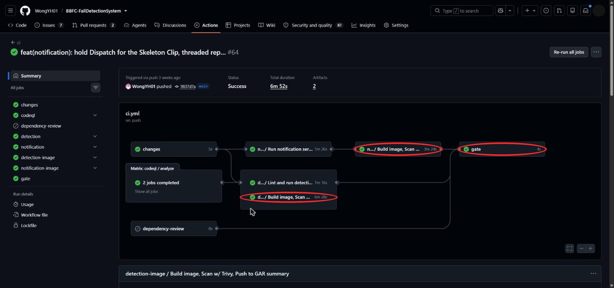

# Workflows

The repo ships its workflows in `.github/workflows/`. You change none of them. This page turns off the one workflow you do not use, and starts the first pipeline run that builds and pushes both images.

By the end of this page you have:

- The `refit` workflow disabled.
- A `ci` run on `main` that went green.
- Both images, `detection` and `notification`, pushed to `bbfc-registry`.

## Needs

The finished [GCP auth and registry](02-gcp-auth-and-registry.md), so the `FALL_WEIGHTS_TOKEN` secret and the four `GCP_*` variables are set.

## Who

agent can run.

- Ask first: `git push origin main` in step 3 starts the pipeline.
- Human provides nothing.

Shell: bash, with a PowerShell variant for the `printf` line in step 3.

## Do

### 1. What each workflow does

Diagrams: a pull request or push to `main` starts `ci`, which calls `detection`, `notification`, `image` and `codeql`. On a push to `main`, `image` pushes to `bbfc-registry`, and Flux reads the registry. The table below lists the same workflows in text.

<details open>
<summary>Pipeline overview</summary>



</details>

<details>
<summary>Detailed pipeline</summary>



</details>

| Workflow | Runs when | Does |
|----------|-----------|------|
| `ci` | Pull request to `main`, push to `main` | Entry point. Runs the others, and the `gate` job reports one pass or fail. |
| `detection` | Called by `ci` | Lints and unit-tests `services/detection`. |
| `notification` | Called by `ci` | Unit-tests `services/notification`. |
| `image` | Called by `ci` | Builds the image, scans it with Trivy, and on a push to `main` pushes it to `<GCP_REGION>-docker.pkg.dev/<GCP_PROJECT_ID>/bbfc-registry/<service>`. |
| `codeql` | Called by `ci`, and Mondays 01:00 UTC | Code scanning for Java and Python. |
| `refit` | Mondays 02:00 UTC, or by hand | Weekly Refit of the Camera Head. Needs a clip bucket and a GitHub App that this guide does not set up. |

`ci` builds only the services whose files changed, plus both when `.github/**` or `docker-compose.yml` changes. Images are pushed only on a push to `main`, never on a pull request.

Every pushed image gets three tags: the commit SHA, `latest`, and `main-<first 8 characters of the SHA>-<unix time>`. Flux deploys the highest `main-*` tag.

### 2. Disable the refit workflow

A fork runs the weekly schedule once Actions is on. `refit` would fail every Monday, so disable it:

```bash
gh workflow disable refit --repo <your-username>/BBFC-FallDetectionSystem
```

Or open the Actions tab, click refit in the sidebar, click the three dots, and choose Disable workflow.

### 3. Run the pipeline

A fresh fork has no change under `services/`, so `ci` would build no image. Add a comment to `docker-compose.yml`, which makes `ci` build both services, and push it. Run this from the repo root:

```bash
printf '\n# first image build\n' >> docker-compose.yml
git add docker-compose.yml
git commit -m "chore: trigger first image build"
git push origin main
```

PowerShell has no `printf`. Replace the first line with:

```powershell
Add-Content docker-compose.yml "`n# first image build"
```

### 4. Wait for the run

```bash
gh run watch --repo <your-username>/BBFC-FallDetectionSystem
```

Select the `ci` run on `main` from the list. The run takes several minutes: the detection image downloads the model weights. All jobs must pass, including `gate`.

On GitHub, open the Actions tab and the run. Both `*-image` jobs and `gate` show a green check. `dependency-review` is skipped on a push.



## Done when

Read-only:

```bash
gh run list --repo <your-username>/BBFC-FallDetectionSystem --workflow ci --branch main --limit 1 --json status,conclusion
gh workflow list --repo <your-username>/BBFC-FallDetectionSystem --all
```

Expected: `"status":"completed","conclusion":"success"`, and `refit` listed as `disabled_manually`.

## If it fails

- [CI builds no image](../troubleshooting.md#ci-builds-no-image)
- [Refit fails on Mondays](../troubleshooting.md#refit-fails-on-mondays)
- [Code scanning or dependency review fails](../troubleshooting.md#code-scanning-or-dependency-review-fails)

## Next

[Flux bootstrap](04-flux-bootstrap.md)
