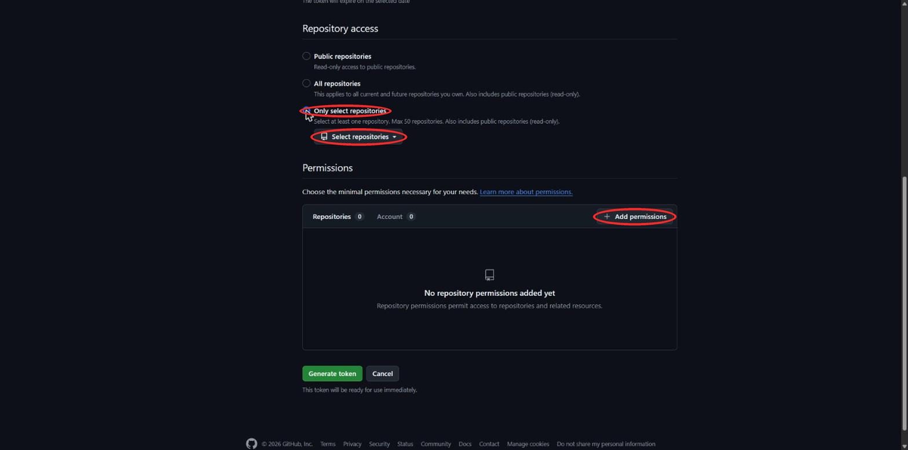

# Flux Bootstrap

Flux runs inside the GKE cluster. It applies `infra/k8s` from your fork, watches `bbfc-registry` for new image tags, and pushes the new tags to a branch of your fork.

By the end of this page you have:

- The registry path in the Flux and Kubernetes files pointing at your project.
- Flux installed in the `bbfc` cluster, syncing your fork.
- The image reflector and image automation controllers running.

## Needs

The finished [Workflows](03-workflows.md), and the `bbfc` cluster. Create the cluster first in [Provision](../05-cloud/01-provision.md), then come back here. You also need [flux](../01-prerequisites/README.md#cloud-only) and kubectl installed.

## Who

human only creates the token, human provides it, and the agent continues.

- Human only: create the fine-grained GitHub token in the GitHub console (step 3).
- Human provides: the token, and `<GCP_ZONE>`. The agent puts it in `GITHUB_TOKEN` for the one shell, never prints or commits it, and unsets it after bootstrap.
- Ask first: `git push origin main` and `flux bootstrap`, which commits to `main`.

Shell: bash, with PowerShell variants noted in steps 3 and 4.

## Do

### 1. Point the files at your registry

The Flux and Kubernetes files name the upstream project's registry. In your fork, replace `asia-southeast1-docker.pkg.dev/fyp-elderly-detection/bbfc-registry` with `<GCP_REGION>-docker.pkg.dev/<GCP_PROJECT_ID>/bbfc-registry` in these files:

| File | Occurrences |
|------|-------------|
| `infra/flux/detection.yml` | 1 (`spec.image`) |
| `infra/flux/notification.yml` | 1 (`spec.image`) |
| `infra/k8s/kustomization.yml` | 2 (`newName`) |

Leave the `newTag` lines as they are. Flux rewrites them.

Check that none of these three files still names the upstream project:

```bash
git grep -n "fyp-elderly-detection" -- infra/flux infra/k8s/kustomization.yml
```

The command prints nothing when you are done. Then push:

```bash
git add infra/flux infra/k8s/kustomization.yml
git commit -m "chore(infra): point Flux at my registry"
git push origin main
```

### 2. Connect kubectl to the cluster

```bash
gcloud container clusters get-credentials bbfc --zone <GCP_ZONE> --dns-endpoint
kubectl get nodes
```

`<GCP_ZONE>` is the zone of the cluster, for example `asia-southeast1-a`. One node must show `Ready`.

### 3. Create a GitHub token for Flux

Flux bootstrap creates a deploy key in your fork, so it needs a token with admin rights on it.

1. On GitHub open your profile menu, Settings, Developer settings, Personal access tokens, Fine-grained tokens, Generate new token.
2. Under Repository access choose Only select repositories, and pick your fork.
3. Under Repository permissions set Administration to Read and write, Contents to Read and write, and Metadata to Read-only.
4. Generate the token and copy it.



Put it in the shell where you run the next command. Do not commit it.

```bash
export GITHUB_TOKEN=<your-token>
```

On PowerShell: `$env:GITHUB_TOKEN = "<your-token>"`.

### 4. Bootstrap Flux

```bash
flux check --pre

flux bootstrap github \
  --owner=<your-username> \
  --repository=BBFC-FallDetectionSystem \
  --branch=main \
  --path=infra/flux \
  --personal \
  --components-extra=image-reflector-controller,image-automation-controller
```

The path `infra/flux` and both extra controllers are required: the image automation manifests in `infra/flux` need them.

The command commits to `main` of your fork: it rewrites `infra/flux/flux-system/gotk-components.yaml` and `gotk-sync.yaml`, and the repo URL in `gotk-sync.yaml` becomes your fork. Pull that commit:

```bash
git pull origin main
```

You can unset the token now:

```bash
unset GITHUB_TOKEN
```

On PowerShell: `Remove-Item Env:GITHUB_TOKEN`.

### 5. Check Flux

```bash
flux check
kubectl -n flux-system get pods
```

`flux check` ends with `all checks passed`. The pods include `image-reflector-controller` and `image-automation-controller`, all `Running`.

## Done when

Read-only:

```bash
flux check
kubectl -n flux-system get pods
git grep -n "fyp-elderly-detection" -- infra/flux infra/k8s/kustomization.yml
```

Expected: `flux check` ends with `all checks passed`. The pods include `image-reflector-controller` and `image-automation-controller`, all `Running`. `git grep` prints nothing.

## If it fails

- [Flux deploy key stops working](../troubleshooting.md#flux-deploy-key-stops-working)
- [bbfc-apps is not True](../troubleshooting.md#bbfc-apps-is-not-true)
- [kubectl points at the wrong cluster](../troubleshooting.md#kubectl-points-at-the-wrong-cluster)

## Next

[Verify pipeline](05-verify-pipeline.md)
