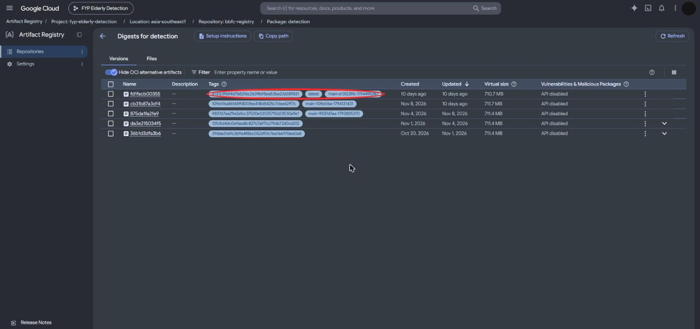

# Verify Pipeline

This page confirms the whole pipeline: a push to `main` built two images, pushed them to the registry, and Flux saw them and wrote the new tags back to your fork.

By the end of this page you have:

- Both images, with their tags, listed in `bbfc-registry`.
- Flux syncing your fork and reading both image repositories.
- The image tags in `infra/k8s/kustomization.yml` updated on `main` by Flux's commit.

Needs: the finished [Flux bootstrap](04-flux-bootstrap.md), and the first `ci` run from [Workflows](03-workflows.md) green.

## 1. Check the registry

```bash
gcloud artifacts docker images list <GCP_REGION>-docker.pkg.dev/<GCP_PROJECT_ID>/bbfc-registry --include-tags
```

You see `detection` and `notification`. Each has the tags `latest`, the full commit SHA, and one tag named `main-<8 characters>-<unix time>`.

In the console, open Artifact Registry, `bbfc-registry`, then `detection`. The newest row has the tags `latest`, the full commit SHA and `main-<8 characters>-<unix time>`.



## 2. Check that Flux reads the registry

```bash
flux get sources git
flux get image repository
flux get image policy
```

Expected:

- `flux get sources git`: `flux-system` is `True` and its message names `main@sha1:...`.
- `flux get image repository`: `detection` and `notification` are `True`, each with `successful scan, found` tags.
- `flux get image policy`: `detection` and `notification` are `True`, and the latest image is the `main-...` tag from the registry.

The image reflector scans every 5 minutes. To scan now:

```bash
flux reconcile image repository detection
flux reconcile image repository notification
```

## 3. Merge Flux's tag update

When the policy picks a tag that differs from the `newTag` lines, Flux commits the new tags to a branch named `flux-image-updates` in your fork. Flux creates the branch. Check that it exists:

```bash
flux reconcile image update flux-system
git fetch origin flux-image-updates
git log origin/flux-image-updates -1 --format=%s
```

The last command prints `chore(infra): update deployed image tags`.

Merge it into `main` and push:

```bash
git switch main
git pull origin main
git merge origin/flux-image-updates
git push origin main
```

The push starts a `ci` run. It builds no image, because only `infra/` changed.

## 4. Confirm the sync

```bash
git grep -n "newTag" infra/k8s/kustomization.yml
flux reconcile source git flux-system
flux get kustomizations
```

Both `newTag` lines name `main-...` tags that exist in your registry. `flux-system` shows `True` and `Applied revision: main@sha1:...` for your latest commit.

`bbfc-apps` becomes `True` only after the [Cloud pages](../05-cloud/01-provision.md) are done: it needs the Kubernetes secrets and the Tailscale setup. The pipeline is complete when steps 1 to 4 above hold.

## Next

[Cloud: Provision](../05-cloud/01-provision.md)
