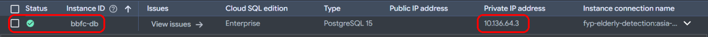
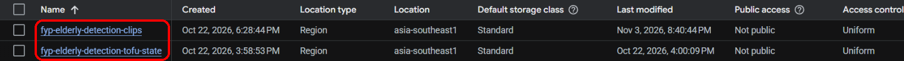
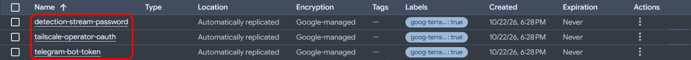
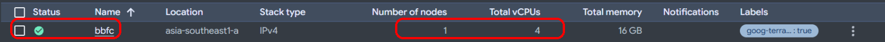

# Provision Cloud Infra

OpenTofu creates the cloud resources in two roots under `infra/tofu`. `base` holds the data and lives as long as the project: network, Cloud SQL, the clip bucket, Secret Manager secrets and IAM. `cluster` holds the GKE cluster `bbfc`, which you can destroy and recreate without losing data.

By the end of this page you have:

- A state bucket for OpenTofu.
- The `base` root applied: network, Cloud SQL `bbfc-db`, the clip bucket, three secrets, IAM.
- The values of the Telegram and stream secrets stored in Secret Manager.
- The database user `notification@<GCP_PROJECT_ID>.iam` allowed to create its schema.
- The `cluster` root applied: GKE cluster `bbfc` with one node.

## Needs

The finished [GCP auth and registry](../04-ci-cd-bootstrap/02-gcp-auth-and-registry.md) page (the registry `bbfc-registry` and the service account `gha-pusher` must exist), the [cloud tools](../01-prerequisites/README.md#cloud-only), and the Telegram bot token from the [prerequisites](../01-prerequisites/README.md#telegram). Run the commands in bash (Git Bash on Windows), from the repo root.

## Who

human provides values and approves every apply, and the agent continues.

- Human only: `gcloud auth login` and `gcloud auth application-default login` (browser), and the `GRANT` in Cloud SQL Studio (step 6, a console action).
- Human provides: `<GCP_PROJECT_ID>`, `<GCP_REGION>`, `<GCP_ZONE>`, `TELEGRAM_BOT_TOKEN`, `STREAM_PASSWORD` and `<POSTGRES_ADMIN_PASSWORD>`. The agent never prints or commits them.
- Confirm first: every `tofu apply` (steps 4 and 7). Show the `tofu plan` and wait for a yes. A plan with a destroy is a stop.

Shell: bash (Git Bash on Windows), from the repo root.

## Do

### 1. Set the shell variables

```bash
gcloud auth login
gcloud auth application-default login
gcloud config set project <GCP_PROJECT_ID>

export PROJECT_ID=<GCP_PROJECT_ID>
export REGION=<GCP_REGION>            # the region of bbfc-registry, for example asia-southeast1
export ZONE=<GCP_ZONE>                # a zone in that region, for example asia-southeast1-a
export PROJECT_NUMBER=$(gcloud projects describe "$PROJECT_ID" --format='value(projectNumber)')
```

`application-default login` gives OpenTofu its credentials.

### 2. Enable the APIs

```bash
gcloud services enable \
  container.googleapis.com sqladmin.googleapis.com servicenetworking.googleapis.com \
  secretmanager.googleapis.com compute.googleapis.com cloudresourcemanager.googleapis.com
```

### 3. Create the state bucket

OpenTofu cannot create the bucket that holds its own state. Both roots use this bucket.

```bash
gcloud storage buckets create "gs://$PROJECT_ID-tofu-state" --location="$REGION"
gcloud storage buckets update "gs://$PROJECT_ID-tofu-state" --versioning
```

The repo names the upstream project's bucket, `fyp-elderly-detection-tofu-state`, in three files. Replace it with yours:

```bash
sed -i "s/fyp-elderly-detection-tofu-state/$PROJECT_ID-tofu-state/" \
  infra/tofu/base/versions.tf infra/tofu/cluster/versions.tf infra/tofu/cluster/base.tf
git grep -n "fyp-elderly-detection" -- infra/tofu
```

The `git grep` prints nothing. Commit the change:

```bash
git add infra/tofu
git commit -m "chore(infra): use my OpenTofu state bucket"
git push origin main
```

### 4. Apply the `base` root

Create `infra/tofu/base/terraform.tfvars`. Git ignores it. `clip_bucket_name` is the name of the new clip bucket. Bucket names are global, so pick one nobody has: `<GCP_PROJECT_ID>-clips` is a good choice.

```bash
cat > infra/tofu/base/terraform.tfvars <<EOF
project_id       = "$PROJECT_ID"
project_number   = "$PROJECT_NUMBER"
region           = "$REGION"
zone             = "$ZONE"
clip_bucket_name = "$PROJECT_ID-clips"
EOF
```

Apply:

```bash
cd infra/tofu/base
tofu init
tofu plan
tofu apply
cd ../../..
```

The plan shows the import of `bbfc-registry` and no destroy. Type `yes` at the prompt. The apply takes about 15 minutes: Cloud SQL is the slow part.

The apply creates:

- The VPC `bbfc-vpc`, the subnet `bbfc-subnet`, private service access for Cloud SQL, and the firewall rule `bbfc-allow-tailscale-udp` (UDP 31641).
- The Cloud SQL instance `bbfc-db` (PostgreSQL 15, private IP only, IAM login on) and the database user `notification@<GCP_PROJECT_ID>.iam`.
- The clip bucket.
- The service accounts `gke-nodes` and `notification`, with their IAM bindings.
- Three empty secrets: `telegram-bot-token`, `detection-stream-password` and `tailscale-operator-oauth`.
- A cleanup policy on `bbfc-registry`: the 5 most recent versions are kept, anything older than 15 days is deleted.

Check:

```bash
cd infra/tofu/base && tofu output && tofu plan; cd ../../..
```

`tofu plan` ends with `No changes.`

In the console, open SQL. `bbfc-db` shows a green tick (Runnable) and a private IP address only.



Open Cloud Storage, Buckets. Your clip bucket and the state bucket are listed, both Not public.



Open Security, Secret Manager. The three secrets are listed.



### 5. Store the secret values

OpenTofu creates the secrets empty, so the values never enter its state. Add them by hand. `<STREAM_PASSWORD>` is the password you set on the Pi's MediaMTX in [Configure MediaMTX](../02-pi-camera/README.md#6-configure-mediamtx).

```bash
printf '%s' '<TELEGRAM_BOT_TOKEN>' | gcloud secrets versions add telegram-bot-token --data-file=-
printf '%s' '<STREAM_PASSWORD>' | gcloud secrets versions add detection-stream-password --data-file=-
```

Each command prints `Created version [1] of the secret`. `printf` adds no trailing newline: a newline would end up in the password.

`tailscale-operator-oauth` is filled in [Kubernetes and Tailscale](02-k8s-and-tailscale.md).

### 6. Let the database user create its schema

The notification service creates the `alerts` schema at startup, logged in as the IAM database user. That user needs permission on the database. Set a password for the built-in `postgres` user, which you use once:

```bash
gcloud sql users set-password postgres --instance=bbfc-db --password='<POSTGRES_ADMIN_PASSWORD>'
```

In the console, open SQL, `bbfc-db`, Cloud SQL Studio. Choose database `postgres`, user `postgres`, and enter the password. Run:

```sql
GRANT CREATE ON DATABASE postgres TO "notification@<GCP_PROJECT_ID>.iam";
```

Studio reports the statement as run without an error. Replace `<GCP_PROJECT_ID>` with your project ID.

### 7. Apply the `cluster` root

This root needs no `terraform.tfvars`: it reads the outputs of `base` from the state bucket.

```bash
cd infra/tofu/cluster
tofu init
tofu plan
tofu apply
cd ../../..
```

The apply takes about 10 minutes. It creates the GKE Standard cluster `bbfc` in `<GCP_ZONE>`, with Workload Identity and secret sync on, and the node pool `main` with one `e2-standard-4` node.

Check:

```bash
gcloud container clusters get-credentials bbfc --zone "$ZONE" --dns-endpoint
kubectl get nodes
```

One node shows `Ready`.

In the console, open Kubernetes Engine, Clusters. `bbfc` shows a green tick, 1 node, 4 vCPUs and 16 GB.



## Done when

Read-only:

```bash
cd infra/tofu/base && tofu output && tofu plan; cd ../../..
gcloud container clusters get-credentials bbfc --zone "$ZONE" --dns-endpoint
kubectl get nodes
```

Expected: `tofu plan` ends with `No changes.`, and one node shows `Ready`. `gcloud secrets versions list telegram-bot-token` and `gcloud secrets versions list detection-stream-password` each list version `1`.

## If it fails

- [bbfc-apps is not True](../troubleshooting.md#bbfc-apps-is-not-true)
- [kubectl points at the wrong cluster](../troubleshooting.md#kubectl-points-at-the-wrong-cluster)

## Next

Flux must already be bootstrapped. If it is not, do [Flux bootstrap](../04-ci-cd-bootstrap/04-flux-bootstrap.md) and [Verify pipeline](../04-ci-cd-bootstrap/05-verify-pipeline.md) first. Then continue to [Kubernetes and Tailscale](02-k8s-and-tailscale.md).
