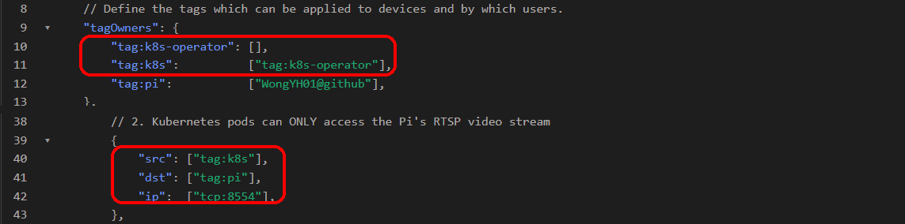
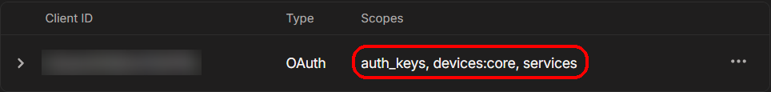
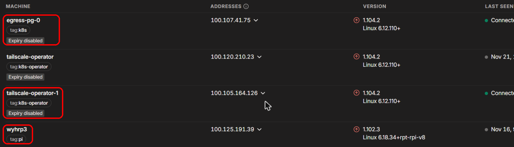
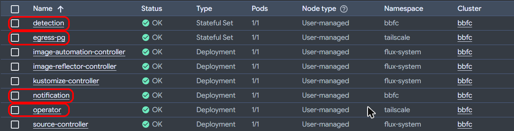

# Kubernetes and Tailscale

The cluster reaches the Pi's camera stream through the Tailscale Kubernetes operator. This page installs the operator, creates the Kubernetes settings that are not in git, and lets Flux deploy `notification` and `detection`.

By the end of this page you have:

- The manifests in `infra/k8s` pointing at your project and your Pi.
- A Tailscale policy and OAuth client for the operator, and the operator running in the `tailscale` namespace.
- The ConfigMaps `notification` and `detection` in the `bbfc` namespace.
- The Flux kustomization `bbfc-apps` `True`, with both workloads running.

Needs: the finished [Provision](01-provision.md) page, a bootstrapped Flux ([Flux bootstrap](../04-ci-cd-bootstrap/04-flux-bootstrap.md)), the Pi on your tailnet ([Pi camera](../02-pi-camera/README.md#4-reach-the-pi-from-any-network)), and [helm](../01-prerequisites/README.md#cloud-only). Run the commands in bash (Git Bash on Windows), from the repo root.

## 1. Point the manifests at your project

[Flux bootstrap](../04-ci-cd-bootstrap/04-flux-bootstrap.md) already changed the registry path. Three more files name the upstream project:

```bash
sed -i "s/fyp-elderly-detection/<GCP_PROJECT_ID>/g" \
  infra/k8s/notification/secrets.yml \
  infra/k8s/detection/secrets.yml \
  infra/k8s/notification/serviceaccount.yml
```

`infra/k8s/tailscale/egress-service.yml` names the upstream Pi in the annotation `tailscale.com/tailnet-fqdn`. Replace its value with your Pi's full tailnet name, `<pi-name>.<tailnet>.ts.net`. Find it on the Pi:

```bash
tailscale status --json | grep -m1 DNSName
```

The value ends with a dot. Leave the dot out. You can also read it in the Tailscale admin console, Machines, under the Pi's name. Then check:

```bash
git grep -n -e "fyp-elderly-detection" -e "wyhrp3" -- infra/k8s infra/flux
```

The command prints nothing. Push:

```bash
git add infra/k8s
git commit -m "chore(infra): point manifests at my project and Pi"
git push origin main
```

## 2. Set the Tailscale policy

Open the Tailscale admin console, Access controls, JSON editor. Add the entries below. If the file already has a `tagOwners` or `grants` block, add the entries to it. `<your-tailscale-login>` is your Tailscale login, for example `<username>@github`.

```json
"tagOwners": {
  "tag:k8s-operator": [],
  "tag:k8s":          ["tag:k8s-operator"],
  "tag:pi":           ["<your-tailscale-login>"]
},
"grants": [
  {
    "src": ["tag:k8s"],
    "dst": ["tag:pi"],
    "ip":  ["tcp:8554"]
  }
]
```

Save. Without the grant the proxy starts but the RTSP stream times out.



Then tag the Pi. Open Machines, click the three dots on the Pi's row, Edit ACL tags, choose `tag:pi`, and save. The Pi's row now shows `tag:pi`.

## 3. Create the OAuth client

1. In the admin console open Settings, Trust credentials, Credential, OAuth.
2. Give it the scopes Devices Core: Write, Auth Keys: Write and Services: Write.
3. For each scope that asks for tags, choose `tag:k8s-operator`.
4. Generate. Copy the client ID and the client secret. The secret is shown once.

The client is listed with the scopes `auth_keys`, `devices:core` and `services`.



Store both in Secret Manager as two lines, client ID first:

```bash
printf '%s\n%s' '<TS_CLIENT_ID>' '<TS_CLIENT_SECRET>' | gcloud secrets versions add tailscale-operator-oauth --data-file=-
```

## 4. Install the Tailscale operator

Flux does not install the operator. Install it by hand, once per cluster:

```bash
gcloud container clusters get-credentials bbfc --zone <GCP_ZONE> --dns-endpoint

OAUTH=$(gcloud secrets versions access latest --secret=tailscale-operator-oauth)
TS_CLIENT_ID=$(echo "$OAUTH" | sed -n 1p)
TS_CLIENT_SECRET=$(echo "$OAUTH" | sed -n 2p)

helm repo add tailscale https://pkgs.tailscale.com/helmcharts
helm repo update
helm upgrade --install tailscale-operator tailscale/tailscale-operator \
  --version '~1.104.0' \
  --namespace tailscale --create-namespace \
  --set-string oauth.clientId="$TS_CLIENT_ID" \
  --set-string oauth.clientSecret="$TS_CLIENT_SECRET" \
  --wait
```

Check:

```bash
kubectl -n tailscale get pods
```

The `operator` pod is `Running`. In the Tailscale admin console, Machines lists a machine named `tailscale-operator` with the tag `tag:k8s-operator`, next to the Pi with `tag:pi`. After a reinstall the new machine is named `tailscale-operator-1`: delete the old, offline entry.



## 5. Create the ConfigMaps

The ConfigMaps hold per-deployment settings. They are not in git: the `config.env` files are gitignored. Create the namespace first:

```bash
kubectl apply -f infra/k8s/namespace.yml
```

### Notification

```bash
cp infra/k8s/notification/config.env.example infra/k8s/notification/config.env
```

Edit `infra/k8s/notification/config.env`:

| Name | Value |
|------|-------|
| `SPRING_DATASOURCE_URL` | In the line, replace `fyp-elderly-detection:asia-southeast1:bbfc-db` with the output of `cd infra/tofu/base && tofu output -raw sql_connection_name`, which has the form `<GCP_PROJECT_ID>:<GCP_REGION>:bbfc-db`. Keep the rest of the line. |
| `DB_USERNAME` | `notification@<GCP_PROJECT_ID>.iam` |
| `CLIPS_GCS_BUCKET` | The `clip_bucket_name` from `terraform.tfvars`, for example `<GCP_PROJECT_ID>-clips` |
| `TELEGRAM_CHAT_GROUP_ID` | The [chat group ID](../01-prerequisites/README.md#chat-group-id) |

Keep `POSTGRES_PASSWORD`, `SUPABASE_SERVICE_KEY`, `CLIPS_STORE`, `CLIPS_ENSURE_BUCKET` and `JAVA_OPTS` as they are.

### Detection

```bash
cp infra/k8s/detection/config.env.example infra/k8s/detection/config.env
```

Edit `infra/k8s/detection/config.env`:

| Name | Value |
|------|-------|
| `ROOM_ID`, `ROOM_NAME` | Any label for the room the camera watches. `ROOM_ID` names the folder of the room's clips in the bucket. |
| `MEDIAMTX_BROWSER_HOST` | The Pi's tailnet name, `<pi-name>.<tailnet>.ts.net`, as in step 1 |
| `STREAM_USERNAME` | The user you set on the Pi's MediaMTX |

Keep `MEDIAMTX_HOST=pi-mediamtx`. It is the in-cluster name of the Tailscale egress service. Keep the other lines.

### Create them

```bash
kubectl -n bbfc create configmap notification --from-env-file=infra/k8s/notification/config.env --dry-run=client -o yaml | kubectl apply -f -
kubectl -n bbfc create configmap detection --from-env-file=infra/k8s/detection/config.env --dry-run=client -o yaml | kubectl apply -f -
```

To change a setting later, edit the file and run the same command, then `kubectl -n bbfc rollout restart deploy/notification` or `kubectl -n bbfc rollout restart sts/detection`.

## 6. Let Flux deploy

Merge Flux's newest tag update first, if the branch exists, as in [Verify pipeline](../04-ci-cd-bootstrap/05-verify-pipeline.md#3-merge-fluxs-tag-update). Then:

```bash
flux reconcile kustomization bbfc-apps --with-source
flux get kustomizations
```

`bbfc-apps` shows `True` and `Applied revision: main@sha1:...`. The reconcile waits for the workloads to become ready and can take several minutes: the detection image is large. If it times out, wait a minute: Flux retries every minute.

```bash
kubectl -n bbfc get pods
```

`notification-...` and `detection-0` are both `1/1 Running`.

In the console, open Kubernetes Engine, Workloads. `detection`, `notification`, `egress-pg` and `operator` show `OK` with pods `1/1`, next to the Flux controllers.



## Next

[Verify](03-verify.md)
