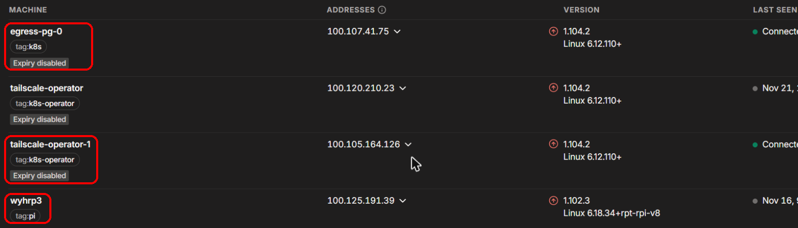

# Verify Cloud Deployment

This page confirms the cloud path end to end: detection on GKE reads the Pi's stream over Tailscale, and a fall sends an alert with its clip to Telegram and stores the alert.

By the end of this page you have:

- Both workloads running in the `bbfc` namespace.
- The Tailscale egress proxy up, and detection receiving frames from the Pi.
- A test alert delivered to Telegram.
- A real fall alert in Telegram, its clip in the clip bucket, and its row in Cloud SQL.

Needs: the finished [Kubernetes and Tailscale](02-k8s-and-tailscale.md) page, the Pi streaming ([Pi camera](../02-pi-camera/README.md#8-confirm-the-stream-works)), and the Telegram bot in your chat group. Run the commands in bash (Git Bash on Windows).

## 1. Check the workloads

```bash
kubectl -n bbfc get pods
flux get kustomizations
```

`notification-...` and `detection-0` are `1/1 Running`. `bbfc-apps` is `True`.

## 2. Check the Tailscale proxy

```bash
kubectl -n tailscale get pods
kubectl -n bbfc get svc pi-mediamtx
```

The `tailscale` namespace has the `operator` pod and the proxy pod `egress-pg-0`, both `Running`. The `EXTERNAL-NAME` of `pi-mediamtx` is no longer `placeholder`.

In the Tailscale admin console, Machines lists a machine for the proxy with the tag `tag:k8s`.



## 3. Check that detection reads the stream

Detection's page has no login, so the cluster does not expose it. Open it through a port-forward:

```bash
kubectl -n bbfc port-forward pod/detection-0 5005
```

Leave it running. In another terminal:

```bash
curl http://localhost:5005/stream/status
```

The reply shows `fps` above `0` and a small `age_sec`, about 1 or less. Run it twice: `age_sec` stays small and does not climb.

Open `http://localhost:5005`. The live camera feed shows with the pose overlay, as in [Local deployment](../03-local/README.md#4-open-the-detection-page). The page's live view works only on a device on your tailnet.

Stop the port-forward with Ctrl+C.

## 4. Check that an alert reaches Telegram

Send a test alert to the notification service:

```bash
kubectl -n bbfc port-forward svc/notification 8081
```

In another terminal:

```bash
curl -X POST http://localhost:8081/api/v1/notification/events \
  -H "Content-Type: application/json" \
  -d '{"eventId":"cloud-test-001","roomId":"room-1","roomName":"Cloud test","confidence":0.92}'
```

The reply is `{"eventId":"cloud-test-001","status":"accepted"}`. The Telegram group receives a `FALL DETECTED` message for `Cloud test` within a few seconds, after up to 20 seconds of waiting for a clip that never comes. Stop the port-forward with Ctrl+C.

## 5. Confirm a real fall alert

1. Stand in front of the camera and fall, or lie down, as the detector would see a fall. A fall alarm turns on in about 1.3 seconds.
2. The Telegram group receives a `FALL DETECTED` message for your `ROOM_NAME`, followed by the skeleton clip.
3. Tap the acknowledge button on the message. The bot asks `Was this a genuine fall?`. Answer it.

Follow the detection log while you do this:

```bash
kubectl -n bbfc logs -f pod/detection-0
```

### The clip is in the bucket

```bash
gcloud storage ls gs://<CLIP_BUCKET>/<ROOM_ID>/
```

`<CLIP_BUCKET>` is `clip_bucket_name` and `<ROOM_ID>` is the `ROOM_ID` from `infra/k8s/detection/config.env`. The listing has an object `<event-id>.mp4` for the alert.

### The alert is in Cloud SQL

In the console, open SQL, `bbfc-db`, Cloud SQL Studio. Choose database `postgres`, user `postgres` and the password you set in [Provision](01-provision.md#6-let-the-database-user-create-its-schema). Run:

```sql
SELECT event_id, room_id, state, outcome FROM alerts.alerts ORDER BY event_id DESC LIMIT 5;
```

The newest row has your `ROOM_ID`. After you answered the triage question, its `outcome` is filled in.

The cloud path works when the Telegram alert, the clip and the row all exist for the same fall.

## Next

[Operations](../06-operations/README.md)
