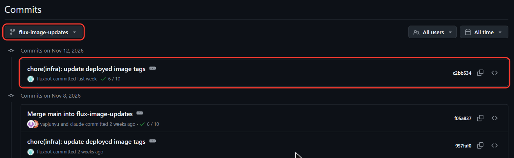

# Operations

This page covers routine running of both paths: update, restart, rotate secrets, and tear the cluster down and bring it back with the data kept.

By the end of this page you have:

- The local stack and the cloud workloads updated to the newest code.
- Restart and log commands for either path.
- The Telegram bot token and the stream password rotated.
- A link to the cluster teardown and rebuild steps, which keep Cloud SQL and the clip bucket.

## Needs

A working deployment, local ([Local deployment](../03-local/README.md)) or cloud ([Verify](../05-cloud/03-verify.md)). Do the section for your path. Run the cloud commands in bash (Git Bash on Windows), from the repo root.

## Who

agent can run, and the human provides new secrets.

- Human provides: the new Telegram bot token, new stream password, or new Tailscale OAuth client when you rotate. The agent never prints or commits them.
- Human only: `/revoke` in BotFather, changing the password on the Pi, generating the OAuth client in the Tailscale console.
- Ask first: registering the scheduled task (it is a persistent system change), `git push origin main`, rollouts that restart a workload, and rotating any secret.

Shell: Local section: bash, and PowerShell where marked. Cloud section: bash (Git Bash on Windows), from the repo root.

## Do

### Local

#### Update

Pull `main`, rebuild and start again. If you are on another branch or have uncommitted changes, stop and ask the operator first: `git switch main` can lose work.


```bash
git switch main
git pull --ff-only
docker compose up -d --build
```

Compose recreates only the containers whose image changed. The database and the clips are kept.

To do this for `detection` every week, register the scheduled task once. Run this in PowerShell from the repo root:

```powershell
$action  = New-ScheduledTaskAction -Execute powershell.exe `
  -Argument "-NoProfile -ExecutionPolicy Bypass -File `"$PWD\infra\local\update-detection.ps1`""
$trigger = New-ScheduledTaskTrigger -Weekly -DaysOfWeek Monday -At 4am
$settings = New-ScheduledTaskSettingsSet -StartWhenAvailable
Register-ScheduledTask -TaskName "bbfc update detection" -Action $action -Trigger $trigger -Settings $settings
```

The task runs as you, while you are logged on. It refuses any branch except `main`, rebuilds `detection`, swaps the container and fails unless the container comes back `healthy`. Run it now:

```powershell
Start-ScheduledTask "bbfc update detection"
Get-Content "$env:LOCALAPPDATA\bbfc\update-detection.log" -Tail 20
```

The log ends with `detection is healthy`. In Task Scheduler the last run result is `0`.

#### Restart

```bash
docker compose restart detection
docker compose restart notification
```

Read the logs:

```bash
docker compose logs -f detection
docker compose logs -f notification
```

#### Rotate secrets

The Telegram bot token: in BotFather send `/revoke` and choose the bot to get a new token. Put it in `TELEGRAM_BOT_TOKEN` in `.env` in the repo root, then:

```bash
docker compose up -d notification
```

The stream password: change it on the Pi first, in `mediamtx.yml` as in [Configure MediaMTX](../02-pi-camera/README.md#6-configure-mediamtx), and restart MediaMTX there. Put the same value in `STREAM_PASSWORD` in `services/detection/.env`, then:

```bash
docker compose up -d detection
```

Check that the stream is back: `http://localhost:5005/stream/status` shows `fps` above `0`.

#### Stop and start

```bash
docker compose down
docker compose up -d
```

`down` keeps the database and the clips. `down -v` deletes them with no undo.

### Cloud

Two things run on the cluster: the `notification` Deployment and the `detection` StatefulSet, both in the `bbfc` namespace. Connect first:

```bash
gcloud container clusters get-credentials bbfc --zone <GCP_ZONE> --dns-endpoint
```

#### Update

Push to `main`. The pipeline does the rest:

1. `ci` builds and pushes the image of each service whose files changed ([Workflows](../04-ci-cd-bootstrap/03-workflows.md#1-what-each-workflow-does)).
2. Flux sees the new `main-...` tag within 5 minutes and commits it to the branch `flux-image-updates` of your fork.
3. You merge that branch into `main`. Flux then applies it.

On GitHub, open your fork, switch to the branch `flux-image-updates` and open its commits. The newest commit is by `fluxbot`: `chore(infra): update deployed image tags`.



Do step 3:

```bash
flux reconcile image update flux-system
git fetch origin flux-image-updates
git switch main
git pull origin main
git merge origin/flux-image-updates
git push origin main
flux reconcile kustomization bbfc-apps --with-source
```

Check:

```bash
git grep -n "newTag" infra/k8s/kustomization.yml
kubectl -n bbfc get pods
flux get kustomizations
```

Both pods are `1/1 Running` and `bbfc-apps` is `True`. A `ci` run on the merge commit builds no image: only `infra/` changed.

A change under `infra/k8s` is applied by Flux when it lands on `main`, within 10 minutes, or at once with `flux reconcile kustomization bbfc-apps --with-source`.

#### Change a setting

The two ConfigMaps come from the gitignored `config.env` files. Edit `infra/k8s/notification/config.env` or `infra/k8s/detection/config.env`, then apply and restart:

```bash
kubectl -n bbfc create configmap notification --from-env-file=infra/k8s/notification/config.env --dry-run=client -o yaml | kubectl apply -f -
kubectl -n bbfc create configmap detection --from-env-file=infra/k8s/detection/config.env --dry-run=client -o yaml | kubectl apply -f -
kubectl -n bbfc rollout restart deploy/notification
kubectl -n bbfc rollout restart sts/detection
```

#### Restart

```bash
kubectl -n bbfc rollout restart deploy/notification
kubectl -n bbfc rollout restart sts/detection
kubectl -n bbfc rollout status deploy/notification
kubectl -n bbfc rollout status sts/detection
```

Read the logs:

```bash
kubectl -n bbfc logs -f deploy/notification
kubectl -n bbfc logs -f pod/detection-0
```

If the camera stream stops, restart the Tailscale egress proxy:

```bash
kubectl -n tailscale rollout restart sts/egress-pg
kubectl -n tailscale get pods
```

`egress-pg-0` is `Running` again after a minute.

#### Rotate the Telegram bot token

In BotFather send `/revoke` and choose the bot to get a new token. Add it as a new version of the secret:

```bash
printf '%s' '<NEW_TELEGRAM_BOT_TOKEN>' | gcloud secrets versions add telegram-bot-token --data-file=-
```

The Kubernetes Secret `notification` is a copy that GKE syncs from Secret Manager. Wait until it holds the new value. The two hashes must match:

```bash
kubectl -n bbfc get secret notification -o jsonpath='{.data.TELEGRAM_BOT_TOKEN}' | base64 -d | sha256sum
printf '%s' '<NEW_TELEGRAM_BOT_TOKEN>' | sha256sum
```

Then restart, so the pod reads it:

```bash
kubectl -n bbfc rollout restart deploy/notification
```

#### Rotate the stream password

Change the password on the Pi first, in `mediamtx.yml` as in [Configure MediaMTX](../02-pi-camera/README.md#6-configure-mediamtx), and restart MediaMTX there. Then add it to Secret Manager:

```bash
printf '%s' '<NEW_STREAM_PASSWORD>' | gcloud secrets versions add detection-stream-password --data-file=-
```

Wait until the Kubernetes Secret `detection` holds it. The two hashes must match:

```bash
kubectl -n bbfc get secret detection -o jsonpath='{.data.STREAM_PASSWORD}' | base64 -d | sha256sum
printf '%s' '<NEW_STREAM_PASSWORD>' | sha256sum
```

Then restart:

```bash
kubectl -n bbfc rollout restart sts/detection
```

Check: `kubectl -n bbfc port-forward pod/detection-0 5005`, then in another terminal `curl http://localhost:5005/stream/status` shows `fps` above `0`. Stop the port-forward with Ctrl+C.

#### Rotate the Tailscale OAuth client

In the Tailscale admin console open Settings, Trust credentials, and generate a new OAuth client as in [step 3 of Kubernetes and Tailscale](../05-cloud/02-k8s-and-tailscale.md#3-create-the-oauth-client). Delete the old client. Store the new one and reinstall the operator with it:

```bash
printf '%s\n%s' '<TS_CLIENT_ID>' '<TS_CLIENT_SECRET>' | gcloud secrets versions add tailscale-operator-oauth --data-file=-

OAUTH=$(gcloud secrets versions access latest --secret=tailscale-operator-oauth)
TS_CLIENT_ID=$(echo "$OAUTH" | sed -n 1p)
TS_CLIENT_SECRET=$(echo "$OAUTH" | sed -n 2p)

helm repo add tailscale https://pkgs.tailscale.com/helmcharts
helm repo update
helm upgrade --install tailscale-operator tailscale/tailscale-operator \
  --version '~1.104.0' \
  --namespace tailscale --create-namespace \
  --set-string oauth.clientId="$TS_CLIENT_ID" \
  --set-string oauth.clientSecret="$TS_CLIENT_SECRET" \
  --wait
```

#### Tear the cluster down and bring it back

See [Tear down and bring back the cluster](teardown.md). The data in Cloud SQL and the clip bucket is kept.

## Done when

Read-only. Local:

```bash
docker compose ps
curl http://localhost:5005/stream/status
```

Cloud:

```bash
kubectl -n bbfc get pods
flux get kustomizations
```

On a first bring-up of the local path, skip this: step 3 already ran it. Expected: containers `running` (`notification` `healthy`) and `fps` above `0`, or both pods `1/1 Running` and `bbfc-apps` `True`.

## If it fails

- [Camera stream stops on the cluster](../troubleshooting.md#camera-stream-stops-on-the-cluster)
- [Kubernetes Secret holds the old value](../troubleshooting.md#kubernetes-secret-holds-the-old-value)
- [Flux does not see the new tag](../troubleshooting.md#flux-does-not-see-the-new-tag)
